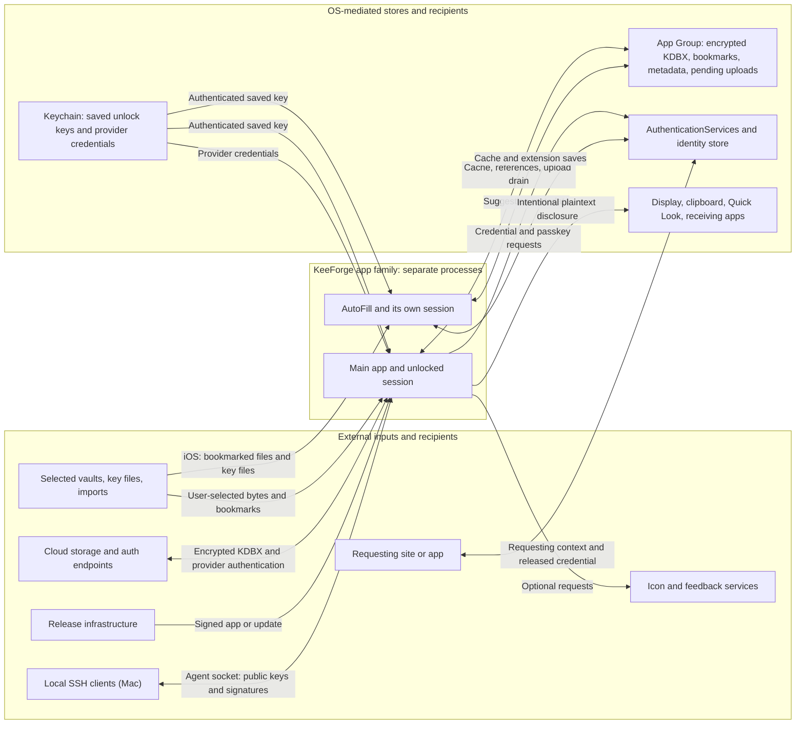

# KeeForge threat model

## Overview

This is the maintained threat model for KeeForge on iPhone, iPad, and macOS, including its AutoFill extensions and distribution channels. Start with the assets and boundary invariants below when changing the product; the resource inventory records implementation details. The scenarios are review hypotheses, not confirmed vulnerabilities or evidence of a completed security audit. Vulnerability reporting is governed by [SECURITY.md](../SECURITY.md); detailed Mac constraints live in [KeeForgeMac/SECURITY.md](../KeeForgeMac/SECURITY.md).

KeeForge opens user-selected or cloud-hosted KeePass databases, decrypts them locally, and returns encrypted KDBX bytes to storage. KDBX 4.x supports editing; KDBX 3.1 is read-only. Users can unlock with a password and/or key file, use an authenticated saved unlock key, and, on supported iOS hardware, require a YubiKey challenge response. AutoFill runs in a separate process with access to shared encrypted caches and Keychain items. It can also save credentials, including passkey registrations, so it is part of the write boundary.

| Component | Responsibility and source anchors |
| --- | --- |
| App session | Unlock, editing, save policy, and lock lifecycle: [KeeForge/ViewModels/DatabaseViewModel.swift:1032](../KeeForge/ViewModels/DatabaseViewModel.swift#L1033), [lock:2139](../KeeForge/ViewModels/DatabaseViewModel.swift#L2140). |
| Database engine | File validation, key derivation, encryption, and parsing: the KDBXKit package reads and writes the encrypted container ([KDBXContainer.swift:206](../Packages/KDBXKit/Sources/KDBXKit/KDBXContainer.swift#L206), [KDBXContainer+KDBX3.swift:84](../Packages/KDBXKit/Sources/KDBXKit/KDBXContainer+KDBX3.swift#L84)); the app parses its XML into the model ([KDBXParser.swift](../KeeForge/Models/KDBXParser.swift)) and seals secrets under the session key ([EncryptedValue.swift:22](../KeeForge/Models/EncryptedValue.swift#L22)). |
| Persistence and sync | Local baseline checks and backups; remote revision checks and encrypted uploads: [KeeForge/Services/Persistence/LocalDatabaseSaver.swift:244](../KeeForge/Services/Persistence/LocalDatabaseSaver.swift#L245), [KeeForge/Services/Cloud/CloudDatabaseSaver.swift:163](../KeeForge/Services/Cloud/CloudDatabaseSaver.swift#L164). |
| AutoFill | Credential selection, passkey matching, credential creation, and cleanup: [AutoFillExtension/CredentialProviderCoordinator.swift:1598](../AutoFillExtension/CredentialProviderCoordinator.swift#L1599), [registration:2270](../AutoFillExtension/CredentialProviderCoordinator.swift#L2271), [cleanup:2569](../AutoFillExtension/CredentialProviderCoordinator.swift#L2570). |
| Platform and release integration | Keychain, OS credential store, clipboard, previews, network services, Mac quick search, the Mac SSH agent, and direct-Mac updates; concrete boundaries are below. |

Arrows mark data or authority crossings, not blanket trust. Cloud storage, imported files, and requesting clients are untrusted. The OS mediates authentication, entitlements, and requesting-client identity; KeeForge owns credential selection, session handling, and encrypted writes. The Mac extension cannot use the app's external-file or network entitlements, so its file arrow is iOS-only.

## Threat model, trust boundaries, and assumptions

### Assets and objectives

- **Vault confidentiality:** passwords, TOTP seeds, passkey private keys, attachments, history, notes, and custom fields should remain inaccessible without the required unlock factors. Stolen encrypted copies still permit offline password guessing; password strength and key-file custody matter.
- **Key and authentication integrity:** saved unlock keys must retain OS authentication controls. Hardware-key quick unlock must retain the hardware factor; it stores the pre-key, not the final composite key, and never an express-unlock key. The express-unlock key caches one file version's KDF output so quick unlock can skip the KDF; it must open nothing that the saved composite key could not, and only the version it was derived for ([ExpressUnlockKey.swift:11](../KeeForge/Models/ExpressUnlockKey.swift#L12)). Hardware-key transport is currently available only in the iOS app, not Mac or either extension ([HardwareKeyService.swift:8](../KeeForge/Services/Security/HardwareKeyService.swift#L9)).
- **Correct disclosure:** AutoFill should release the intended credential to the OS-mediated request, respect per-database selection, and bind passkey assertions to the relying party and allowed credential. A password fill resolves `{REF:…}` field references against the whole database ([Coordinator:2595](../AutoFillExtension/CredentialProviderCoordinator.swift#L2596)), so values a website or relying party supplies are never saved with a reference: save-password and passkey registration refuse them ([save check:2154](../AutoFillExtension/CredentialProviderCoordinator.swift#L2155), [registration check:525](../AutoFillExtension/CredentialProviderCoordinator.swift#L526)). A new entry's URL keeps only the site's scheme, host, and port, and a supplied title holding a reference is dropped ([initial draft:112](../KeeForge/Services/AutoFill/AutoFillSaveCoordinator.swift#L112)). From the password picker, the user can also add the requesting website to any entry they chose; the host comes only from the OS-supplied service identifier, is shown in full beside the entry's saved URLs with a caution when it shares no registrable domain with them, and is written only on confirmation as a new `KP2A_URL_<n>` field. A user who confirms a lookalike domain makes that entry a suggestion on the phishing site, so the confirmation is the control ([URL addition](../AutoFillExtension/CredentialProviderCoordinator.swift#L39)). Publishing suggestion metadata must not publish passwords or private keys. Where the OS store cannot be enumerated (iOS and macOS 27.0.1), KeeForge cannot remove one database's identities selectively: disabling or removing a database clears the whole store, and with several AutoFill databases enabled the metadata of a deleted or changed entry can stay published until the store is next cleared ([refresh without enumeration:749](../KeeForge/Services/AutoFill/CredentialIdentityStoreManager.swift#L749)). Password identities do expose domains, usernames or fallback titles, and record identifiers to the OS ([CredentialIdentityStoreManager.swift:862](../KeeForge/Services/AutoFill/CredentialIdentityStoreManager.swift#L862)).
- **SSH signing authority (Mac):** the private-key attachments of the entries chosen for the SSH agent, and the ability to sign with them, belong to the unlocked session; no key is exported or stored by the agent. The agent does give its clients public key blobs and key comments or entry titles, and Settings shows the entry titles and key fingerprints of the unlocked vault. The socket path is fixed and not a secret. Whether the agent is on and which entry UUIDs each database serves are kept in the app's own preferences, outside the vault: they cannot add a key the unlocked vault does not hold, but they decide which of its keys are served ([MacSSHAgentController.swift:159](../KeeForge/Services/SSHAgent/MacSSHAgentController.swift#L159), [SettingsService.swift:515](../KeeForge/Services/AppSupport/SettingsService.swift#L515), [SettingsService.swift:524](../KeeForge/Services/AppSupport/SettingsService.swift#L524)).
- **Integrity and recoverability:** saves should preserve the vault, detect conflicting changes, retain encrypted backups, and avoid losing extension-created credentials during later sync. KDBX 4.x authenticates its header and payload, but even a valid copy can be stale. KDBX 3.1 has no authenticated outer header and checks its decrypted block stream with unkeyed SHA-256 hashes ([KDBXContainer+KDBX3.swift:103](../Packages/KDBXKit/Sources/KDBXKit/KDBXContainer+KDBX3.swift#L103), [hashed blocks:177](../Packages/KDBXKit/Sources/KDBXKit/KDBXContainer+KDBX3.swift#L177)).
- **Availability and privacy:** hostile files, KDF parameters, server responses, and imported content should not cause uncontrolled resource use or unintended disclosure. Logs, optional network features, and plaintext metadata must be considered separately from encrypted vault bytes.

### Actors and boundaries

The legitimate user selects databases, authorizes unlocks, chooses recipients, and configures storage. Relevant attackers may possess an encrypted vault; supply a malicious file, key file, attachment, CSV import, or incoming URL; control a cloud server or network path; operate a phishing site or requesting app; or run local software with its existing OS permissions. These capabilities do not inherently grant the vault key, biometric approval, access to another sandbox, or update-signing authority. Reporting-policy exclusions do not erase the corresponding product and privacy boundaries.

| Crossing | Invariant and enforcing control | Limitation or review focus |
| --- | --- | --- |
| Untrusted vault bytes → database engine | Bound pre-authentication work; verify KDBX 4.x header and block HMACs before using authenticated content. A cached express-unlock key replaces the KDF only when its binding (HMAC under the composite key over the file's KDF parameters) matches, and it still has to pass the header HMAC; otherwise the KDF runs under the same policy ([ExpressUnlockKey.swift:114](../KeeForge/Models/ExpressUnlockKey.swift#L115)). AutoFill checks every opened header, express or not, against its own ceiling and offers no write it could not save ([CredentialProviderCoordinator.swift:1475](../AutoFillExtension/CredentialProviderCoordinator.swift#L1476)). Argon2 has context-specific memory, work, and parallelism ceilings, and decompression has an output ceiling ([KDBXContainer.swift:247](../Packages/KDBXKit/Sources/KDBXKit/KDBXContainer.swift#L247), [KDF checks:533](../Packages/KDBXKit/Sources/KDBXKit/KDBXContainer.swift#L533), [KDFExecutionPolicy+App.swift:13](../KeeForge/Models/KDFExecutionPolicy+App.swift#L13), [budget check:32](../Packages/KDBXKit/Sources/KDBXKit/KDFExecutionPolicy.swift#L32), [KDBXCrypto.swift:521](../Packages/KDBXKit/Sources/KDBXKit/KDBXCrypto.swift#L521)). | KDBX 3.1 has different integrity checks; parser and native-dependency resource safety is not established by these limits. |
| Selected vault or key file → app and extension | Associate each file with the intended database. New and refreshed macOS key-file bookmarks grant read-only scope; database bookmarks retain write access, and existing writable key-file bookmarks still resolve ([SecurityScopedBookmarkManager.swift:16](../KeeForge/Services/Persistence/SecurityScopedBookmarkManager.swift#L16)). `database-list.json` contains database and key-file bookmarks, not their file bytes ([DatabaseReference.swift:7](../KeeForge/Models/DatabaseReference.swift#L8), [DatabaseListStore.swift:705](../KeeForge/Services/Persistence/DatabaseListStore.swift#L705)). A key file KeeForge creates holds 32 bytes from `SecRandomCopyBytes` in the KeePass XML 2.0 format. It is written only where the user saves it in the system file dialog, then read back and bookmarked like a selected key file ([KeyFileGenerator.swift:10](../Packages/KDBXKit/Sources/KDBXKit/KeyFileGenerator.swift#L10), [KeyFileExportDocument.swift:24](../KeeForge/Views/DatabaseList/KeyFileExportDocument.swift#L24)). | A bookmark is sensitive access metadata, subject to OS capabilities. A created key file is stored unencrypted wherever the user saves it, which may be a synced folder, and KeeForge keeps no other copy. iOS AutoFill may follow selected-file and key-file bookmarks; Mac AutoFill has no external-file entitlement and uses the encrypted cache ([Coordinator:1514](../AutoFillExtension/CredentialProviderCoordinator.swift#L1515), [file read:1511](../AutoFillExtension/CredentialProviderCoordinator.swift#L1512), [Mac entitlements](../AutoFillExtension/AutoFillExtensionMac.entitlements)). |
| Locked state and saved key → usable session | Keychain authentication and database decryption gate session creation; hardware-key quick unlock retains the hardware factor. Selected secrets are sealed with a session AES-GCM key. A completed lock clears that key, parsed contents, drafts, attachment references, and preview files ([KeychainService.swift:121](../KeeForge/Services/Security/KeychainService.swift#L122), [EncryptedValue.swift:22](../KeeForge/Models/EncryptedValue.swift#L22), [DatabaseViewModel.swift:2139](../KeeForge/ViewModels/DatabaseViewModel.swift#L2140)). | Unsaved editors or drafts can defer a requested lock indefinitely ([lock deferral:2201](../KeeForge/ViewModels/DatabaseViewModel.swift#L2202)); session encryption does not cover every plaintext copy. |
| App and AutoFill → OS credential broker → requesting site or app | The extension has its own session; KeeForge binds picker actions to the active request and presentation, including across database switches, and must bind selection to the enabled database, entry, and relying party. Passkey registration saves before success; published suggestion identities carry metadata, not secrets ([picker actions:1909](../AutoFillExtension/CredentialProviderCoordinator.swift#L1910), [RP match:1802](../AutoFillExtension/CredentialProviderCoordinator.swift#L1803), [identity publication:862](../KeeForge/Services/AutoFill/CredentialIdentityStoreManager.swift#L862)). | The OS supplies requesting context. Shared storage and Keychain authority make app and extension collaborators, not mutually isolated principals. Check cancellation, database switches, and cleanup. |
| Unlocked session → local file, App Group, or cloud | Local writes check an open-time SHA-512 baseline, check it again inside the coordinated replace so a concurrent coordinated save conflicts instead of being overwritten, and back up encrypted bytes. Cloud writes check provider revisions where the provider supports an effective conditional write. AutoFill persists a provisional upload marker before saving and finalizes its payload hash afterward. For a bookmarked local database, Mac AutoFill saves encrypted bytes to the shared copy and a pending local save; the app merges them into its unlocked session and writes the original file after unlock ([LocalDatabaseSaver.swift:279](../KeeForge/Services/Persistence/LocalDatabaseSaver.swift#L280), [CloudDatabaseSaver.swift:174](../KeeForge/Services/Cloud/CloudDatabaseSaver.swift#L175), [AutoFillSaveCoordinator.swift:149](../KeeForge/Services/AutoFill/AutoFillSaveCoordinator.swift#L149)). | This is not a global rollback ledger. FTP has no atomic conditional write; OneDrive session uploads above 4 MiB check `If-Match` at session creation, leaving a concurrent-write window before commit ([FTPCloudProvider.swift:177](../KeeForge/Services/Cloud/FTPCloudProvider.swift#L178), [OneDriveCloudProvider.swift:682](../KeeForge/Services/Cloud/OneDriveCloudProvider.swift#L682)). |
| Incoming iOS URL → cloud authentication or vault action | Route Dropbox and OneDrive OAuth callbacks to their provider handlers before interpreting `otpauth://` or database URLs; a callback must belong to its initiated authentication and intended account ([KeeForgeApp.swift:628](../KeeForge/App/KeeForgeApp.swift#L628), [CloudProviderRegistry.swift:52](../KeeForge/Services/Cloud/CloudProviderRegistry.swift#L52)). | Callback validation is delegated to the provider SDKs and needs targeted review when authentication changes. Mac ships neither OAuth provider nor callback scheme. |
| Unlocked session → display, clipboard, preview, or network recipient | Explicit copying and sharing release plaintext. Mac quick search reads the active unlocked session from a non-activating panel; password copy prompts for device-owner authentication and rechecks the session, while username and verification-code copy do not ([MacQuickSearchViewModel.swift:91](../KeeForge/ViewModels/MacQuickSearchViewModel.swift#L91), [copy:171](../KeeForge/ViewModels/MacQuickSearchViewModel.swift#L171)). | Mac screen-capture and clipboard controls are best effort. Optional icons disclose domains to DuckDuckGo; feedback sends user content and optional contact/photo to `feedback.keeforge.com` ([FaviconView.swift:45](../KeeForge/Views/Components/FaviconView.swift#L45), [FeedbackSubmissionService.swift:110](../KeeForge/Services/AppSupport/FeedbackSubmissionService.swift#L110)). |
| Entry editor → custom-field protection | Turning protection on hides the value; turning it off for an existing entry uses the same session-bound device-owner gate as reveal ([EntryEditView.swift](../KeeForge/Views/Entry/EntryEditView.swift), [EntrySecretAction.swift](../KeeForge/ViewModels/EntrySecretAction.swift)). Explicit editor payloads persist the chosen standard KDBX protection, while other callers preserve existing flags ([DatabaseDraft.swift](../KeeForge/Models/DatabaseDraft.swift)). | Protection controls display and KDBX serialization; arbitrary custom-field values still have the plaintext-memory limitation below. History retains its prior values and flags. |
| Local SSH client → Mac SSH agent → unlocked session | The opt-in agent listens on an owner-only Unix socket in the app container and accepts only peers running as the same user. Each request reads the user-chosen entries of the active session; nothing is offered while that session is locked, closed, or has a lock pending (including Retry Save and Lock's write), and a signature is withheld if the lease or the entry's key attachment changed while signing. Private keys are read per request from the decrypted attachment pool, and a parsed key is reused only under the same lease with identical key file bytes; no key file is written. At most 64 connections are open, and a further one takes the place of the connection that has gone longest without a complete request ([MacSSHAgentController.swift:159](../KeeForge/Services/SSHAgent/MacSSHAgentController.swift#L159), [SSHAgentRequestHandler.swift:237](../KeeForge/Services/SSHAgent/SSHAgentRequestHandler.swift#L237), [socket mode:132](../KeeForge/Services/SSHAgent/SSHAgentSocketServer.swift#L132), [connection limit:202](../KeeForge/Services/SSHAgent/SSHAgentSocketServer.swift#L202), [peer check:237](../KeeForge/Services/SSHAgent/SSHAgentSocketServer.swift#L237)). | Clients are of two kinds: processes running as the same user, which the agent cannot tell apart from the intended SSH client, and a remote host only where the user forwarded the agent to it. Either can list the chosen public keys and obtain signatures while the vault is unlocked. There is no per-signature confirmation and no binding of a signature to a destination (`session-bind@openssh.com` is refused), and a confirmation or lifetime constraint in an entry's `KeeAgent.settings` is not applied. Agent traffic cannot add or change a key. A peer of another user is refused by the peer check, which has no test with such a peer. |
| Vault attachment → SSH key parser and Settings key list (Mac) | Key files and `KeeAgent.settings` come out of an authenticated vault, so a hostile one needs somebody who can already write to that vault (an import, a collaborator, a shared database). A key file or settings attachment over 64 KiB is refused before it is decoded, RSA keys are limited to 1024–16384 bits, agent messages to 256 KiB in both directions, and all attachments together to the 256 MiB KDBX limit. Keys are parsed off the main thread. A parsed key is cached only for its entry, session lock cycle, and exact file content, and the cache is emptied when the session locks or a lock becomes pending, the selection or vault content changes, or the agent stops. Settings lists titles and fingerprints only for the unlocked session, hides them while another app is frontmost, and receives the resign-active privacy cover ([key file limit:68](../KeeForge/Services/SSHAgent/SSHAgentKey.swift#L68), [RSA limit:277](../KeeForge/Services/SSHAgent/SSHAgentKey.swift#L277), [settings limit:48](../KeeForge/Services/SSHAgent/SSHAgentRequestHandler.swift#L48), [message limit:180](../KeeForge/Services/SSHAgent/SSHAgentRequestHandler.swift#L180), [KDBXCrypto.swift:521](../Packages/KDBXKit/Sources/KDBXKit/KDBXCrypto.swift#L521), [concealment:76](../KeeForge/Services/SSHAgent/MacSSHAgentController.swift#L76)). | Every request reads the session on the main thread and compares each chosen key file with the cached one; a file that fails to parse is parsed again on each request. There is no request rate limit and no per-connection deadline, so a same-user client can keep the app busy within those per-request bounds; the effect on lock latency and the cost of a 16384-bit RSA signature (parsing makes one to validate the key) are not measured. How the covered Settings window and capture blocking look in Mission Control and to ScreenCaptureKit is not validated on a signed build. |
| Entry editor → reorder previews | Custom-field drag reordering uses a native list containing field names only ([EntryCustomFieldOrderSheet.swift](../KeeForge/Views/Entry/EntryCustomFieldOrderSheet.swift)). | Field values must not be rendered in reorder rows or previews. |
| Source and release infrastructure → installed executable | Dependencies, signing, Apple distribution, and direct-update signing/publication must yield the intended signed artifact with sandboxing and Hardened Runtime ([verify_mac_artifact.sh:97](../ci_scripts/verify_mac_artifact.sh#L97), [channel checks:215](../ci_scripts/verify_mac_artifact.sh#L215)). | Direct Mac builds add Sparkle installer Mach-service exceptions that must not enter App Store builds ([KeeForgeMacDirect.entitlements:49](../KeeForgeMac/KeeForgeMacDirect.entitlements#L49)). A malicious accepted update can access unlocked secrets. The Homebrew cask in [KeeForge/homebrew-tap](https://github.com/KeeForge/homebrew-tap) pins the direct zip's URL and SHA-256, so write access to that repository decides what a first `brew install` downloads; Homebrew keeps the quarantine attribute, so Gatekeeper still requires a notarized Developer ID app, and later updates arrive through Sparkle. |

### Assumptions, limitations, and open questions

- The OS, Keychain, authentication UI, cryptographic implementations, and signed release are trusted. Root/kernel compromise or unrestricted inspection of an unlocked process defeats these controls. The [vulnerability reporting policy](../SECURITY.md#scope) has separate scope exclusions; those exclusions do not remove ordinary unlocked-device disclosure, cloud-provider behavior, or KDBX-version differences from design review.
- Session encryption does not conceal all in-memory content: arbitrary protected custom fields and unrecognized XML can retain plaintext, and Swift/framework copies cannot all be reliably erased. The [Mac security model](../KeeForgeMac/SECURITY.md#secrets-in-memory) records these shared limitations.
- iOS auto-lock measures inactivity: foreground touches (including scrolling and buttons) and text-field/text-view edits in the app window extend the deadline, throttled to once per second. These observers retain no input contents and ignore inactive activity; background locking and the preserved deadline on return still apply ([IOSUserActivityObserver.swift](../KeeForge/App/IOSUserActivityObserver.swift), [session timer](../KeeForge/ViewModels/DatabaseViewModel.swift#L3566)).
- Mac automatic quick unlock is opt-in, needs Touch ID itself, and starts only on a foreground database opening, native app/window activation, or a screen unlock or session switch back while KeeForge stays active, with a key, visible window and no attached sheet. It rechecks eligibility and the captured lock cycle after activation observers finish; lock-cycle changes alone never raise a prompt. Cancellation and password fallback do not repeat automatically in the same cycle ([MacBiometricAutoUnlock.swift](../KeeForge/App/MacBiometricAutoUnlock.swift)).
- The Require Master Password interval bounds how long saved unlock keys live and are used; it is enforced when the app or AutoFill would read them, not by the Keychain. Its per-database entry date sits in the App Group defaults, so code that can write that container could postpone it. A clock set back past the interval counts as due, but a clock moved back by less shortens the elapsed time ([QuickUnlockKeychain.swift:112](../KeeForge/Services/Security/QuickUnlockKeychain.swift#L112)).
- Under the strict Mac auto-lock policy, KeeForge's own system authentication prompt can keep the session open while unanswered. The monitor checks the foreground application's bundle identifier and system-volume path; another application coming forward requests a lock. After the prompt ends, KeeForge has two seconds to reactivate before a lock is requested. Screen lock, sleep, screensaver, session resignation, window closure, and inactivity locking still apply ([MacLockMonitor.swift:303](../KeeForge/Services/AppSupport/MacLockMonitor.swift#L303), [prompt completion:318](../KeeForge/Services/AppSupport/MacLockMonitor.swift#L318)).
- On iOS, a shield covers the app while it is in the background, including the app switcher's snapshot, and while the screen is recorded, mirrored, or AirPlayed, including while Face ID, Control Center, or notifications briefly report the capture as over and after the app becomes active again; while it is up it takes touches and closes the keyboard ([ScreenProtectionService.swift](../KeeForge/Services/Security/ScreenProtectionService.swift)). It relies on iOS reporting the capture, cannot cover what an overlay shows above it, and cannot stop a camera pointed at the screen. Screen-capture blocking on Mac is best effort, not a boundary against Screen Recording or Accessibility permission. Mac clipboard concealment is advisory; its clear timer cannot survive termination and cannot prevent Universal Clipboard. iOS uses local-only, expiring pasteboard items. Preview deletion is not secure erasure, and receiving apps may retain copies ([ClipboardService.swift:22](../KeeForge/Services/AppSupport/ClipboardService.swift#L22), [Mac clipboard:51](../KeeForge/Services/AppSupport/ClipboardService.swift#L51), [Mac screen privacy](../KeeForgeMac/SECURITY.md#screen-and-clipboard-privacy)).
- Network protection depends on the selected provider. WebDAV requires HTTPS by default, allows explicit HTTP opt-in, and refuses cross-origin redirects. FTP uses plaintext TCP, exposing its login and traffic metadata to the network; KDBX encryption protects vault contents, not transport credentials ([WebDAVModels.swift:60](../KeeForge/Services/Cloud/WebDAVModels.swift#L60), [WebDAVClient.swift:342](../KeeForge/Services/Cloud/WebDAVClient.swift#L342), [FTPClient.swift:102](../KeeForge/Services/Cloud/FTPClient.swift#L102)).
- Cloud conflict protection differs by provider. FTP lacks atomic conditional writes. OneDrive overwrites above 4 MiB use upload sessions whose `If-Match` check occurs at session creation rather than commit, leaving a window for a concurrent remote write to be replaced ([FTPCloudProvider.swift:177](../KeeForge/Services/Cloud/FTPCloudProvider.swift#L178), [OneDriveCloudProvider.swift:682](../KeeForge/Services/Cloud/OneDriveCloudProvider.swift#L682)).
- A cloud database may open a cached copy when its sync policy is manual or the provider is unavailable. Successful KDBX authentication establishes that the copy has not failed its format integrity checks, not that it is the newest remote copy ([CloudSyncCoordinator.swift:60](../KeeForge/Services/Cloud/CloudSyncCoordinator.swift#L61)).
- Current code enables WebDAV and FTP on Mac, with Dropbox and OneDrive additionally available on iOS ([CloudSyncModels.swift:60](../KeeForge/Services/Cloud/CloudSyncModels.swift#L60)); the maintained Mac security document agrees.
- The Mac SSH agent has been exercised unsigned and through unit tests, including OpenSSH's own `ssh-add` and `ssh-keygen` against the socket. Not yet established, and to be treated as open questions rather than known defects: its behavior in a signed, sandboxed build (whether a client outside the container reaches the socket), authentication against a real host, `git`, and a forwarded agent end to end ([Mac security model](../KeeForgeMac/SECURITY.md#ssh-agent)).
- This source-based model does not verify deployed server settings, installed entitlements, dependency vulnerabilities, release-key custody, or all parser resource bounds. Those require targeted validation when the corresponding boundary changes. A valid encrypted file can still be stale or contain hostile content supplied by someone who knows its key.

### Effective resource inventory

Container paths below are relative to the OS-resolved location, not fixed device paths. They describe production behavior. Injected unit tests instead use `<temporary directory>/KeeForgeUnitTestAppGroup/group.com.keevault.shared` and the `group.com.keevault.shared.unit-tests` defaults suite. In production, failure to resolve the group directory falls back to the process temporary directory; defaults independently fall back to standard defaults if the suite is unavailable ([AppGroupContainer.swift:28](../KeeForge/Services/Persistence/AppGroupContainer.swift#L28)). Neither fallback guarantees app/extension sharing.

| Deployment and resource | Effective location or configuration | Access and enforcing control | Evidence and limitation |
| --- | --- | --- | --- |
| App Group caches and metadata | `group.com.keevault.shared`: `database-list.json`, `databases/<database UUID>.kdbx`, `cloud-cache/<sanitized provider-account>/<SHA256(file ID)>.kdbx`, `Library/Application Support/backups/<database UUID>/`, and `pending-uploads/<database UUID>/<marker UUID>.json`. | App and extension share the container. KDBX protects vault contents; references, bookmarks, and upload metadata remain outside vault encryption. | [AppGroupContainer.swift:31](../KeeForge/Services/Persistence/AppGroupContainer.swift#L31), [DatabaseListStore.swift:19](../KeeForge/Services/Persistence/DatabaseListStore.swift#L19), [cache paths:1302](../KeeForge/Services/Persistence/DatabaseListStore.swift#L1302), [PendingUploadQueue.swift:407](../KeeForge/Services/Cloud/PendingUploadQueue.swift#L407). Temporary-directory fallback does not establish cross-process sharing. |
| Selected vault and key-file bookmarks | `DatabaseReference.bookmarkData` and `keyFileBookmarkData` are encoded in the shared database list. The selected files themselves remain at their OS- or provider-resolved locations. | The main app resolves both; iOS AutoFill can use supported security-scoped access. Mac AutoFill lacks the external-file entitlement and normally reads the shared encrypted cache. | [DatabaseReference.swift:7](../KeeForge/Models/DatabaseReference.swift#L8), [DatabaseListStore.swift:705](../KeeForge/Services/Persistence/DatabaseListStore.swift#L705), [Coordinator:1514](../AutoFillExtension/CredentialProviderCoordinator.swift#L1515), [file read:1511](../AutoFillExtension/CredentialProviderCoordinator.swift#L1512). A bookmark is access metadata, not a copy of the key file. |
| Saved quick-unlock key | Per-database item in the first team-prefixed `com.keevault.sharedkeychain` Keychain group, service `com.keevault.app`, account `compositeKey:<database UUID>`. Hardware-key databases store a pre-key rather than the final composite key. | App and extension can request an item subject to Data Protection Keychain `WhenUnlockedThisDeviceOnly` and current biometric policy. Mac app items also allow an authorized Apple Watch; Mac AutoFill's calling policy remains biometric-only. The item, with the express-unlock item, is deleted before use once the master key was last entered longer ago than the Require Master Password interval (default Never); the entry date lives in the App Group defaults, only a typed master key moves it, and removing the database drops it with the items. The Always setting keeps no item: unlocks store nothing and choosing it deletes every saved key ([due check:112](../KeeForge/Services/Security/QuickUnlockKeychain.swift#L112), [expiry:129](../KeeForge/Services/Security/QuickUnlockKeychain.swift#L129)). | [KeychainService.swift:15](../KeeForge/Services/Security/KeychainService.swift#L16), [item creation:121](../KeeForge/Services/Security/KeychainService.swift#L122), [hardware-key unlock:4240](../KeeForge/ViewModels/DatabaseViewModel.swift#L4241). |
| Express-unlock key | Same group and service, account `expressUnlockKey:<database UUID>`: a version byte, a 32-byte binding, and the 32-byte KDBX 4 KDF output of the version last opened by the app or AutoFill, or saved by the app. Never written for a hardware-key database or KDBX 3.1. | Same protection class and access control as the quick-unlock item. The app and both AutoFill extensions read it, with the context that released the quick-unlock item and no prompt of its own, and write it right after that item. Storing or deleting the quick-unlock item (app or extension) deletes it first. It opens only the version it was derived for, since every save rotates the KDF salt, and grants nothing the quick-unlock item does not: an app save stores the saved version's key only while that item holds the session's composite key, and a rekey or encryption-settings change only drops it. | [KeychainService.swift:37](../KeeForge/Services/Security/KeychainService.swift#L38), [express item:56](../KeeForge/Services/Security/KeychainService.swift#L57), [read:18](../KeeForge/Services/Security/QuickUnlockKeychain.swift#L18), [persist:45](../KeeForge/Services/Security/QuickUnlockKeychain.swift#L45), [save:2667](../KeeForge/ViewModels/DatabaseViewModel.swift#L2668), [hardware-key exclusion:3912](../KeeForge/ViewModels/DatabaseViewModel.swift#L3913), [AutoFill:949](../AutoFillExtension/CredentialProviderCoordinator.swift#L950). |
| Cloud provider credentials | `CloudKeychainAccessGroup` from build settings, or the default Keychain group if absent; service `com.keevault.cloud-token.<provider>`. | Entitled app-family code can access these `AfterFirstUnlockThisDeviceOnly` items without a vault-unlock or biometric gate; the intended consumer is app sync. SDK-managed OAuth caches have separate policies. | [CloudTokenStore.swift:9](../KeeForge/Services/Cloud/CloudTokenStore.swift#L9), [query:62](../KeeForge/Services/Cloud/CloudTokenStore.swift#L62), [iOS setting:118](../project.yml#L117), [Mac setting:191](../project.yml#L189). |
| iOS OAuth callback | App URL schemes for Dropbox and OneDrive return through `onOpenURL` to provider handlers before other link routing. Mac declares no corresponding schemes. | The OS delivers the URL; provider SDKs receive it and are expected to validate the authentication callback. KeeForge must preserve its association with the initiated provider/account flow. | [KeeForgeApp.swift:331](../KeeForge/App/KeeForgeApp.swift#L331), [routing:628](../KeeForge/App/KeeForgeApp.swift#L628), [CloudProviderRegistry.swift:52](../KeeForge/Services/Cloud/CloudProviderRegistry.swift#L52), [iOS Info.plist:13](../KeeForge/Info.plist#L13). |
| iOS optional icons and account metadata | `<App Group>/favicons` and App Group cloud-account defaults. | App family can read this plaintext metadata; requested domains go to `icons.duckduckgo.com`. Website icons default off. | [FaviconService.swift:39](../KeeForge/Services/AppSupport/FaviconService.swift#L39), [SharedVaultStore.swift:35](../KeeForge/Services/Persistence/SharedVaultStore.swift#L35), [SettingsService.swift:314](../KeeForge/Services/AppSupport/SettingsService.swift#L314). |
| Mac optional icons and account metadata | `<app Application Support>/favicons`, with temporary-directory fallback, and app-local defaults for accounts. | Main app can use these resources. Mac AutoFill has no outbound-network entitlement. | [FaviconService.swift:57](../KeeForge/Services/AppSupport/FaviconService.swift#L57), [SharedVaultStore.swift:35](../KeeForge/Services/Persistence/SharedVaultStore.swift#L35), [Mac extension entitlements](../AutoFillExtension/AutoFillExtensionMac.entitlements). |
| Mac menu bar quick search | Optional non-activating panel and global shortcut; settings live in app defaults, off by default. No separate vault cache. | Reads the active unlocked session. Password copy has a device-owner prompt and session recheck; username and verification-code copies do not. Screen-capture blocking remains best effort. | [MacQuickAccessController.swift:26](../KeeForge/Services/AppSupport/MacQuickAccessController.swift#L26), [MacQuickSearchViewModel.swift:91](../KeeForge/ViewModels/MacQuickSearchViewModel.swift#L91), [copy:171](../KeeForge/ViewModels/MacQuickSearchViewModel.swift#L171), [Mac security model](../KeeForgeMac/SECURITY.md#menu-bar-quick-search). |
| Mac SSH agent socket | `<app container home>/ssh-agent.sock` while the agent is on (off by default); enabled state and chosen entry UUIDs per database in app-local defaults. | Owner-only socket mode, container directory permissions, and a same-user peer check. Lists public keys and comments; signs with chosen Ed25519, ECDSA, and RSA (SHA-2 only) keys of the unlocked active session. Limits: 64 connections, 256 KiB per message, 64 KiB per key file. | [MacSSHAgentController.swift:93](../KeeForge/Services/SSHAgent/MacSSHAgentController.swift#L93), [SSHAgentSocketServer.swift:122](../KeeForge/Services/SSHAgent/SSHAgentSocketServer.swift#L122), [Mac security model](../KeeForgeMac/SECURITY.md#ssh-agent). Stopping removes the socket only while it is still the file this agent bound; a crash leaves a stale file that the next start replaces, and a socket another agent (such as a second copy of the app) listens on is left alone and the start refused. Whether software outside the sandbox can change the app's preferences, and so the agent's switch and selection, is not validated; tests of the agent use a defaults suite and socket directory of their own. |
| Attachment preview or share | `<process temporary directory>/attachment-previews/<UUID>/<sanitized filename>`. | KeeForge writes plaintext for Quick Look or a chosen receiving app. iOS uses protected writes; dismissal, lock, and launch cleanup remove local files. | [AttachmentPreviewFileStore.swift:14](../KeeForge/Services/AppSupport/AttachmentPreviewFileStore.swift#L14), [PlatformCompat.swift:327](../KeeForge/Extensions/PlatformCompat.swift#L327). Mac disk protection depends on the OS/FileVault; receiver copies are outside cleanup. |
| iOS database share | `<process temporary directory>/database-share/<UUID>/<export filename>`, written after the user taps Share (Export… in Database Details) for the current copy, or a backup. | The user picks the receiver in the share sheet (Files, AirDrop, another app); it gets the encrypted KDBX bytes, never plaintext. The file is removed when the share sheet closes, and launch cleanup removes any left by a terminated process. Mac exports through a save panel instead and stages nothing. | [DatabaseExportService.swift:104](../KeeForge/Services/Persistence/DatabaseExportService.swift#L104), [DatabaseExportPresenter.swift:138](../KeeForge/Views/DatabaseList/DatabaseExportPresenter.swift#L138). Receiver copies are outside cleanup. |
| Direct Mac update | Direct-build overlay embeds `SUFeedURL` and `SUPublicEDKey`; App Store builds blank updater settings. | Installed app, Sparkle installer services, and release operators handle the signed update. Signatures, signing/notarization, and artifact verification enforce the intended channel. | [SoftwareUpdateService.swift:14](../KeeForge/Services/AppSupport/SoftwareUpdateService.swift#L14), [project-direct.yml:38](../project-direct.yml#L38), [project.yml:198](../project.yml#L196). Installed artifact configuration requires release-time verification. |

## Attack surface, mitigations, and attacker stories

Priority indicates review order by potential impact and reachability, not a finding severity. Existing limitations above are established behavior; failures proposed below are hypotheses. “Mitigation” describes what to preserve or verify, not a claim that a new safeguard has already shipped.

| Priority | Scenario and capability gain | Prerequisites | Impact | Existing controls | Mitigation | Evidence |
| --- | --- | --- | --- | --- | --- | --- |
| 1 | A hostile vault header or authenticated payload drives excessive computation, parser failure, or code execution | User opens attacker-controlled bytes; authenticated payload attacks generally require a valid vault/key | Denial of access; potentially session compromise if an exploitable memory-safety failure exists | Header/block authentication, Argon2 policy, decompression ceiling | Review pre-authentication work separately; test bounds and native parser/crypto dependencies | [KDBXContainer.swift:247](../Packages/KDBXKit/Sources/KDBXKit/KDBXContainer.swift#L247), [KDFExecutionPolicy+App.swift:13](../KeeForge/Models/KDFExecutionPolicy+App.swift#L13), [KDBXCrypto.swift:521](../Packages/KDBXKit/Sources/KDBXKit/KDBXCrypto.swift#L521) |
| 1 | A requesting site/app receives another credential or a passkey assertion for the wrong relying party | Reachable AutoFill flow plus failed selection/authentication checks | Account takeover | Per-database opt-in, session unlock, RP/credential-ID matching, cleanup | Preserve request binding across selection, database switches, cancellation, and authentication callbacks | [Coordinator:1034](../AutoFillExtension/CredentialProviderCoordinator.swift#L1035), [RP checks:1802](../AutoFillExtension/CredentialProviderCoordinator.swift#L1803), [cleanup:2569](../AutoFillExtension/CredentialProviderCoordinator.swift#L2570) |
| 1 | Saved-key access or a stale session bypasses the intended unlock boundary | Access to an exposed app/extension path; OS authorization must not simply be assumed | Vault disclosure | Authenticated device-only Keychain items; lock and cleanup clear session references; the express-unlock key carries the quick-unlock item's protection and is bound to it | Verify every completion after lock/cancellation; retain the hardware factor (no express-unlock key for hardware-key databases); describe deferred locks accurately | [KeychainService.swift:121](../KeeForge/Services/Security/KeychainService.swift#L122), [DatabaseViewModel.swift:2139](../KeeForge/ViewModels/DatabaseViewModel.swift#L2140) |
| 1 | Attacker-supplied application code is accepted as a release/update | Compromised dependency/build/release authority or a verification bypass | Broad credential compromise after users unlock | Code signing, hardened artifacts, direct-update signature verification, publication bound to artifact hashes | Protect signing authority and review release/dependency changes; verify exact distributed artifacts | [SoftwareUpdateService.swift:14](../KeeForge/Services/AppSupport/SoftwareUpdateService.swift#L14), [verify_mac_artifact.sh:97](../ci_scripts/verify_mac_artifact.sh#L97), [release_direct_artifact.sh:318](../ci_scripts/release_direct_artifact.sh#L318) |
| 2 | Storage replacement, rollback, or competing app/extension saves lose credentials or overwrite changes | Provider/file write access or concurrent writers | Integrity and availability loss | Local baselines, encrypted backups, supported provider revision checks, pending-upload payload hashes | Exercise interrupted and conflicting writes; preserve backups; do not claim rollback resistance, FTP compare-and-swap, or commit-time revision protection for OneDrive session uploads above 4 MiB | [LocalDatabaseSaver.swift:279](../KeeForge/Services/Persistence/LocalDatabaseSaver.swift#L280), [CloudDatabaseSaver.swift:174](../KeeForge/Services/Cloud/CloudDatabaseSaver.swift#L175), [OneDriveCloudProvider.swift:682](../KeeForge/Services/Cloud/OneDriveCloudProvider.swift#L682) |
| 2 | Network observer steals provider credentials or a hostile endpoint redirects them | FTP, explicitly enabled HTTP, or a transport/control failure | Cloud-account access and encrypted-vault theft/replacement | HTTPS default and same-origin redirects for WebDAV; vault encryption remains independent | Use authenticated encrypted transport for untrusted networks; keep plaintext modes and endpoint choices explicit | [WebDAVModels.swift:60](../KeeForge/Services/Cloud/WebDAVModels.swift#L60), [WebDAVClient.swift:342](../KeeForge/Services/Cloud/WebDAVClient.swift#L342), [FTPClient.swift:462](../KeeForge/Services/Cloud/FTPClient.swift#L462) |
| 2 | Plaintext or keys escape through shared files, logs, previews, or another local app | An unintended write/disclosure, or OS access to an intentional plaintext output | Secret or sensitive-metadata exposure | Encrypted caches/exports, Keychain, preview cleanup, clipboard expiry/clearing, platform privacy controls | Keep secrets out of metadata/logs; treat database and key-file bookmarks as sensitive; audit shared writers and output lifetimes | [DatabaseReference.swift:7](../KeeForge/Models/DatabaseReference.swift#L8), [AttachmentPreviewFileStore.swift:21](../KeeForge/Services/AppSupport/AttachmentPreviewFileStore.swift#L21), [ClipboardService.swift:22](../KeeForge/Services/AppSupport/ClipboardService.swift#L22) |
| 2 | Mac quick search reveals entry metadata or copies a field after its session changes | Menu bar access while a vault is unlocked, or a callback across a lock or entry change | Unintended disclosure on screen or clipboard | Reads the live unlocked session; password copy prompts for device-owner authentication and rechecks the entry | Preserve the live-session check; remember username and verification-code copy have no fresh owner prompt and capture blocking is best effort | [MacQuickAccessController.swift:26](../KeeForge/Services/AppSupport/MacQuickAccessController.swift#L26), [MacQuickSearchViewModel.swift:171](../KeeForge/ViewModels/MacQuickSearchViewModel.swift#L171), [Mac security model](../KeeForgeMac/SECURITY.md#menu-bar-quick-search) |
| 2 | A local process or forwarded host uses the Mac SSH agent to authenticate as the user | Same-user code execution, or an SSH session the user forwarded the agent to, while the vault is unlocked and the agent is on | Access to SSH servers that trust the chosen keys; private keys themselves are not released | Opt-in agent and per-entry choice, same-user peer check, owner-only socket, no keys offered once the session locks or a lock is pending | Keep the agent off by default and the selection explicit; recheck the lease after signing; do not add key export or agent-side key storage without revisiting this row | [MacSSHAgentController.swift:159](../KeeForge/Services/SSHAgent/MacSSHAgentController.swift#L159), [SSHAgentRequestHandler.swift:237](../KeeForge/Services/SSHAgent/SSHAgentRequestHandler.swift#L237), [Mac security model](../KeeForgeMac/SECURITY.md#ssh-agent) |
| 2 | An incoming OAuth callback is accepted for the wrong initiated login or account | Attacker-controlled callback URL reaches the iOS app and callback validation fails | Wrong account binding or cloud authorization state | Provider SDK handlers receive callbacks before general link routing; their validation guarantees are not verified here | Verify callback state and account binding when changing SDKs, URL schemes, or authentication flow; do not assume a URL scheme authenticates its sender | [KeeForgeApp.swift:628](../KeeForge/App/KeeForgeApp.swift#L628), [CloudProviderRegistry.swift:52](../KeeForge/Services/Cloud/CloudProviderRegistry.swift#L52), [DropboxCloudProvider.swift:261](../KeeForge/Services/Cloud/DropboxCloudProvider.swift#L261), [OneDriveCloudProvider.swift:296](../KeeForge/Services/Cloud/OneDriveCloudProvider.swift#L296) |
| 3 | Imported credentials or an enrollment link mislead the user, consume resources, or replace unintended data | User imports a CSV or follows an `otpauth://` link | Incorrect credentials or enrollment; local denial of service | Import-size ceiling; enrollment replacement decision; normal draft/save flow | Preserve explicit destination/replacement decisions and input validation; remember source CSV remains plaintext | [PasswordImport.swift:83](../KeeForge/Models/PasswordImport.swift#L83), [TOTPEnrollmentViewModel.swift:101](../KeeForge/ViewModels/TOTPEnrollmentViewModel.swift#L101) |
| 3 | A crafted key attachment or stalled clients make the Mac SSH agent or its Settings list unavailable, or the list is read off the screen | Write access to the vault plus the user opening Settings or choosing that entry; a same-user process or forwarded host holding connections; or a bystander while KeeForge is in the background | Recoverable loss of the agent or a busy app; entry titles and key fingerprints seen by a bystander | Size limits applied before decoding, a bounded identities answer, the connection limit with the longest-stalled connection making room, the Settings privacy cover and hidden key rows while another app is frontmost | Check sizes before any decoding of attachment bytes; keep cached keys bound to the lease and exact file content; make new vault-derived Settings content conceal itself; revisit rate and deadline limits if a client class with less privilege than the user appears | [SSHAgentKey.swift:68](../KeeForge/Services/SSHAgent/SSHAgentKey.swift#L68), [SSHAgentSocketServer.swift:202](../KeeForge/Services/SSHAgent/SSHAgentSocketServer.swift#L202), [MacSSHAgentController.swift:76](../KeeForge/Services/SSHAgent/MacSSHAgentController.swift#L76) |
| 3 | Optional services or credential suggestions disclose more metadata than intended | Icons/AutoFill enabled or feedback submitted | Domain, account, or user-content privacy loss | Icons default off, explicit feedback flow, metadata-only credential identities | Keep opt-in and payload boundaries clear; review actual fields and recipients when adding diagnostics | [SettingsService.swift:314](../KeeForge/Services/AppSupport/SettingsService.swift#L314), [FeedbackSubmissionService.swift:143](../KeeForge/Services/AppSupport/FeedbackSubmissionService.swift#L143), [CredentialIdentityStoreManager.swift:862](../KeeForge/Services/AutoFill/CredentialIdentityStoreManager.swift#L862) |

## Severity calibration (Critical, High, Medium, Low)

Severity applies to a validated failure with a demonstrated trust-boundary crossing. Impact, reachability, confidence, and missing evidence should be recorded separately.

| Severity | Example if validated | What would reduce or invalidate that assessment |
| --- | --- | --- |
| Critical | A broadly reachable update-verification bypass or remote exploit that enables large-scale extraction of unlocked vault secrets | Control of the already-trusted release-signing environment is a different prerequisite; replacing an appcast alone does not establish a signature bypass. |
| High | Authentication bypass releasing vault contents, cross-RP passkey use, or exploitable code execution from a vault opened through an ordinary supported flow | The attacker must gain access they did not already have. Inspecting an already-compromised unlocked process is not evidence of a new KeeForge boundary failure. |
| Medium | Attacker-triggered recoverable vault unavailability, meaningful metadata leakage beyond the selected feature, or a write race that loses data under realistic conditions | Scope, required user actions, recoverability, and backups matter. A conflict correctly refused by the saver is a successful control. |
| Low | Limited unintended non-secret disclosure or a minor security-relevant behavior with constrained impact | Authorized copying, expected optional favicon disclosure, and documented platform behavior alone are not vulnerabilities. |

Maintain this model when unlock factors, shared storage, provider transports, AutoFill authority, SSH agent authority, plaintext outputs, or distribution trust change. Keep detailed platform contracts next to their implementation and historical audit results in `docs/audits/`.
