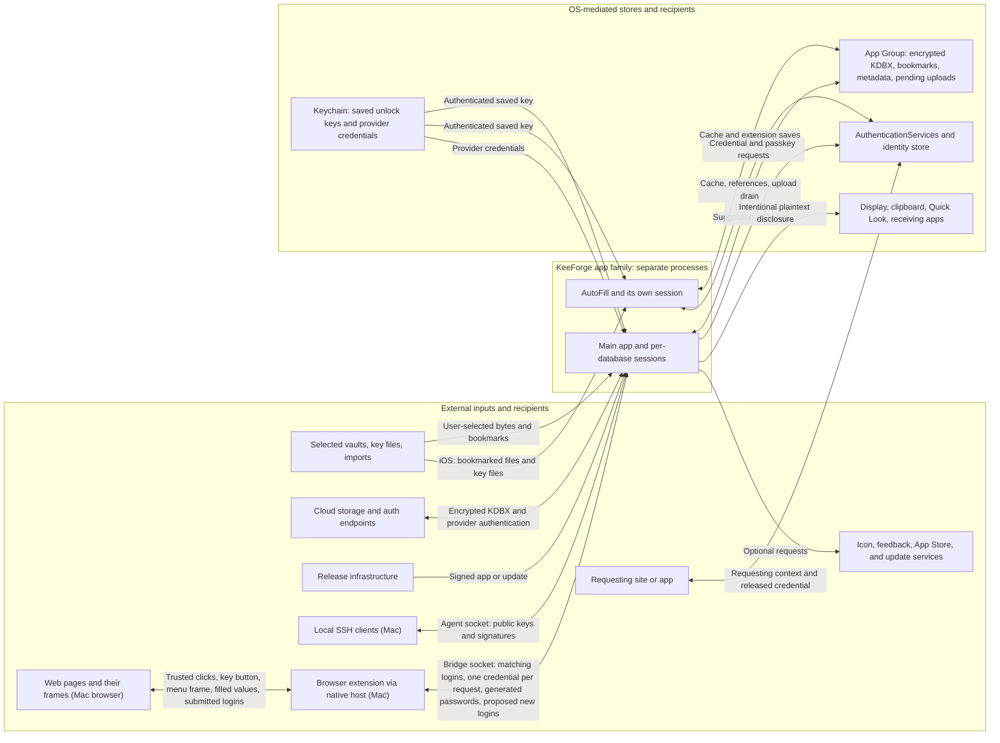

# KeeForge threat model

## Overview

This is the maintained threat model for KeeForge on iPhone, iPad, and macOS, including its AutoFill extensions and distribution channels. Start with the assets and boundary invariants below when changing the product; the resource inventory records implementation details. The scenarios are review hypotheses, not confirmed vulnerabilities or evidence of a completed security audit. Vulnerability reporting is governed by [SECURITY.md](../SECURITY.md); detailed Mac constraints live in [KeeForgeMac/SECURITY.md](../KeeForgeMac/SECURITY.md).

KeeForge opens user-selected or cloud-hosted KeePass databases, decrypts them locally, and returns encrypted KDBX bytes to storage. KDBX 4.x supports editing; KDBX 3.1 is read-only. Users can unlock with a password and/or key file, use an authenticated saved unlock key, and, on supported iOS hardware, require a YubiKey challenge response. AutoFill runs in a separate process with access to shared encrypted caches and Keychain items. It can also save credentials, including passkey registrations, so it is part of the write boundary.

| Component | Responsibility and source anchors |
| --- | --- |
| App sessions | [DatabaseSessionStore](../KeeForge/ViewModels/DatabaseSessionStore.swift) owns sessions by database UUID; each [DatabaseViewModel](../KeeForge/ViewModels/DatabaseViewModel.swift) owns unlock, editing, save policy, and its [lock lifecycle: lock(manuallyTriggered:preservingClipboard:cause:)](../KeeForge/ViewModels/DatabaseViewModel.swift). The iOS interface opens one database at a time ([database transition:225](../KeeForge/App/AppRootView.swift#L225)); the Mac opens each database in its own window ([MacWindowCoordinator](../KeeForgeMac/App/MacWindowCoordinator.swift)). |
| Database engine | File validation, key derivation, encryption, and parsing: the KDBXKit package reads and writes the encrypted container ([KDBXContainer.swift:197](../Packages/KDBXKit/Sources/KDBXKit/KDBXContainer.swift#L197), [KDBXContainer+KDBX3.swift:64](../Packages/KDBXKit/Sources/KDBXKit/KDBXContainer+KDBX3.swift#L64)); the KDBXXML package reads its XML and unmasks protected values ([DocumentReader.swift](../Packages/KDBXXML/Sources/KDBXXML/DocumentReader.swift)); the app maps that document into the model ([KDBXParser.swift](../KeeForge/Models/KDBXParser.swift)) and seals secrets under the session key ([EncryptedValue.swift:22](../KeeForge/Models/EncryptedValue.swift#L22)). |
| Persistence and sync | Local baseline checks and backups; remote revision checks and encrypted uploads: [KeeForge/Services/Persistence/LocalDatabaseSaver.swift:238](../KeeForge/Services/Persistence/LocalDatabaseSaver.swift#L238), [KeeForge/Services/Cloud/CloudDatabaseSaver.swift:164](../KeeForge/Services/Cloud/CloudDatabaseSaver.swift#L164). |
| AutoFill | Credential selection, passkey matching, credential creation, and cleanup: [presentPasswordMatchesOrFinish](../AutoFillExtension/CredentialProviderCoordinator.swift), [registration: presentPasskeyCreator](../AutoFillExtension/CredentialProviderCoordinator.swift), [cleanup](../AutoFillExtension/CredentialProviderCoordinator.swift). |
| Browser bridge (Mac) | Off by default. A Chrome or Firefox extension ([BrowserExtension/AGENTS.md](../BrowserExtension/AGENTS.md)) fills from a key button it draws in login and verification-code fields, through a menu in its own frame ([content.js](../BrowserExtension/src/content.js), [inline.js](../BrowserExtension/src/inline.js)), or from its toolbar popup; for the key button it holds host access to every `https` page and loopback `http` page and runs a content script in each such frame. It reaches the running app through a sandboxed native-messaging host embedded in the app ([BrowserHostRelay.swift](../BrowserHost/BrowserHostRelay.swift)) and a Unix socket in a team-prefixed App Group. The app decides every pairing and release ([MacBrowserBridgeController](../KeeForge/Services/BrowserBridge/MacBrowserBridgeController.swift), [BrowserBridgeRequestHandler](../KeeForge/Services/BrowserBridge/BrowserBridgeRequestHandler.swift)); the wire contract is [browser-bridge-protocol.md](browser-bridge-protocol.md). |
| Platform and release integration | Keychain, OS credential store, clipboard, previews, network services, Mac quick search, the Mac SSH agent, the Mac browser bridge, and direct-Mac updates; concrete boundaries are below. |

Arrows mark data or authority crossings, not blanket trust. Cloud storage, imported files, and requesting clients are untrusted. The OS mediates authentication, entitlements, and requesting-client identity; KeeForge owns credential selection, session handling, and encrypted writes. The Mac extension cannot use the app's external-file or network entitlements, so its file arrow is iOS-only. Web pages are untrusted as well: the browser extension's content script runs inside them, but the logins it lists stay in an extension frame the page cannot read.

The per-database AutoFill toggle commits its registry change before scheduling identity removal. The system suggestion index is an asynchronous best-effort derivative, not authority to authenticate or fill; its existing non-incremental fallback may clear suggestions belonging to other databases. Registry publication and the system index are not an atomic cross-process transaction.

Database removal revokes the pending-local owner before publishing the registry change. If registry publication fails or is unconfirmed, KeeForge retains the cache, keys, pending sources and suggestion identities; an observed revocation is not proof that removal completed or that an unresolved owner is usable. An idle owner can be retried with the same captured database identity.

Cloud metadata learned across an await is published only if the captured cloud identity, revision, local head, epoch and reference preferences still match inside coordinated registry access. A visible but unconfirmed registry publication is not a durable receipt for the caller.

On Mac, [AppDelegate](../KeeForgeMac/App/AppDelegate.swift) owns the session store, lifecycle and lock services, and AppKit menus. [MacWindowCoordinator](../KeeForgeMac/App/MacWindowCoordinator.swift) keeps a Databases window and one window per open database, keyed by the database UUID that also keys the session. Each [DatabaseWindowController](../KeeForgeMac/App/DatabaseWindowController.swift) holds its session directly; content, title, commands, close, enrollment sheets and automatic unlock act only on it, and opening one database never locks or retires another. Menu commands resolve through [MacDatabaseCommandTargetResolver](../KeeForgeMac/App/MacDatabaseCommandTargetResolver.swift) at validation and again at dispatch: the key database window or a key sheet's parent; the main database window when Settings or a panel is key; nothing when the Databases window is key. An authenticated password copy re-checks that the originating controller still owns the session. The Databases window lists and manages references and never shows database contents. Each database window keeps its root host mounted; its unlocked workspace puts a native sidebar outline, a native entry table and a SwiftUI detail host under a native split controller and a native toolbar. A completed lock drops the split controller and toolbar, and the window-owned native sheet/alert presenters end presentations top-down on lock, close and invalidation, reject old lock-cycle callbacks (including deferred Keep Editing authentication and Save and Lock completion), and clear editors and pending actions. Hosted authentication/import cancellation runs synchronously when the shell ends; an in-flight write continues; split autosave retains only geometry and collapse state, per database UUID. The separate retained Settings window reads no window's session and receives the same blur cover and best-effort capture policy; the coordinator applies the capture policy to each window before first showing it. Closing a database window settles its unsaved work through the close guard, then locks and retires only that session, supersedes any opening still in flight, and releases the window; cancel or a failed save keeps both. A locked database window shows only the database's name, file name, storage provider, last-opened time, associated key file's name, the failure and its code, and why it locked, never a path or server address; its Remove from List asks in that window and applies the Databases window's unsaved-work refusal and cleanup ([MacLockedDatabaseSummary](../KeeForge/ViewModels/MacLockedDatabaseSummary.swift), [MacWindowCoordinator](../KeeForgeMac/App/MacWindowCoordinator.swift)). A verification-code link binds to the database window targeted when it arrives, or to a database the user picks in the Databases window; focus changes never retarget it. Hide and minimize do not introduce lock triggers.

Mac per-database settings use an [attached native sheet](../KeeForgeMac/App/MacDatabaseSettingsSheet.swift), owned by the originating workspace's lock cycle, or a reference-only launcher presenter. The launcher omits decrypted destination groups and key-changing actions. [The settings model](../KeeForge/ViewModels/MacDatabaseSettingsModel.swift) reads plaintext header facts and scoped encrypted backups; AutoFill participation retains the list model's refresh bridge. Password/key-file presence flags are session-only display metadata from typed unlock or rekey, cleared on lock; composite-key-only and hardware-key unlocks, and a rekey that reached only the remote, leave composition unknown. A rekey replaces the session's key-file bytes, so a removed key file never returns in the next change. The sheet drops key-file association controls; existing unlock, launcher-row and rekey paths keep their bookmark/storage boundaries. Export still delegates to the existing encrypted-copy exporter. No new plaintext output, key-file writer or authentication path is introduced.

App-global activation, background/system-lock requests, and live Settings effects reach every session retained by [DatabaseSessionStore](../KeeForge/ViewModels/DatabaseSessionStore.swift), regardless of active selection. Each session applies its existing lock policy and unsaved-work deferral. Mac activity resolves the event window, sheet or child parent through the app-owned MacDatabaseWindowRegistry and resets only that database's timer, throttled per database. Settings, panels and unregistered windows extend no deadline. Mac activation evaluates existing deadlines without renewing idle sessions; cache refresh and upload draining remain global. iOS activity retains its all-session fan-out. Unregistering a database window clears pending close callbacks, preventing stale grants after replacement. A Mac database window's committed close retires its session; reopening creates a new, locked window. The application installs list-reconciliation hooks when it creates the shared models, so removing a database from the list force-retires its session and clears its secrets even without a mounted root view. The Mac Databases window refuses that removal while the session has unsaved work or a write in flight, checks again after the confirmation, and shows a refusal raised as the confirmation ends from a per-window native alert queue rather than dropping it ([MacAlertQueue](../KeeForgeMac/App/MacAlertQueue.swift)); a close waits out a write in flight on its session, and a failed master-key or encryption-settings write keeps the window. Reference reconciliation updates only existing sessions, reads the latest persisted reference to avoid rolling back session-written sync metadata, and never reloads decrypted content. An unlocked local session or in-flight write retains its authenticated target and master-key epoch across these callbacks; list metadata cannot authorize a new key epoch.

## Threat model, trust boundaries, and assumptions

### Assets and objectives

- **Vault confidentiality:** passwords, TOTP seeds, passkey private keys, attachments, history, notes, and custom fields should remain inaccessible without the required unlock factors. Stolen encrypted copies still permit offline password guessing; password strength and key-file custody matter.
- **Key and authentication integrity:** saved unlock keys must retain OS authentication controls. Hardware-key quick unlock must retain the hardware factor; it stores the pre-key, not the final composite key, and never an express-unlock key. The express-unlock key caches one file version's KDF output so quick unlock can skip the KDF; it must open nothing that the saved composite key could not, and only the version it was derived for ([ExpressUnlockKey.swift:12](../KeeForge/Models/ExpressUnlockKey.swift#L12)). Hardware-key transport is currently available only in the iOS app, not Mac or either extension ([HardwareKeyService.swift:8](../KeeForge/Services/Security/HardwareKeyService.swift#L9)).
- **Correct disclosure:** AutoFill should release the intended credential to the OS-mediated request, respect per-database selection, and bind passkey assertions to the relying party and allowed credential. A password fill resolves `{REF:…}` field references against the whole database ([completeRequest(with:)](../AutoFillExtension/CredentialProviderCoordinator.swift)), so values a website or relying party supplies are never saved with a reference: save-password and passkey registration refuse them ([save check: saveNewEntry](../AutoFillExtension/CredentialProviderCoordinator.swift), [registration check: prepareInterface(forPasskeyRegistration:)](../AutoFillExtension/CredentialProviderCoordinator.swift)). The same holds for files and links the user brings in: a password-import row with a reference in any column is skipped and listed as such, and an `otpauth://` link's issuer or account name holding one is not used to fill an entry's empty title or user name ([import check](../KeeForge/Models/PasswordImport.swift), [enrollment prefill](../KeeForge/ViewModels/EntryEditViewModel.swift)). A new entry's URL keeps only the site's scheme, host, and port, and a supplied title holding a reference is dropped ([initial draft:116](../KeeForge/Services/AutoFill/AutoFillSaveCoordinator.swift#L116)). A tapped or silent suggestion fills the entry its record identifier names only while that entry still lists the suggestion's host itself, not just a subdomain of it, so an identity left published after a URL change opens the picker instead ([suggestedEntry](../AutoFillExtension/CredentialProviderCoordinator.swift)). From the password picker, the user can also add the requesting website to any entry they chose; the host comes only from the OS-supplied service identifier, is shown in full beside the entry's saved URLs with a caution when it shares no registrable domain with them, and is written only on confirmation as a new `KP2A_URL_<n>` field. A user who confirms a lookalike domain makes that entry a suggestion on the phishing site, so the confirmation is the control ([URL addition: AutoFillURLAddition](../AutoFillExtension/CredentialProviderCoordinator.swift)). Publishing suggestion metadata must not publish passwords or private keys. Where the OS store cannot be enumerated (iOS and macOS 27.0.1), KeeForge cannot remove one database's identities selectively: disabling or removing a database clears the whole store, and with several AutoFill databases enabled the metadata of a deleted or changed entry can stay published until the store is next cleared ([refresh without enumeration:749](../KeeForge/Services/AutoFill/CredentialIdentityStoreManager.swift#L749)). Password identities do expose domains, usernames or fallback titles, and record identifiers to the OS ([CredentialIdentityStoreManager.swift:852](../KeeForge/Services/AutoFill/CredentialIdentityStoreManager.swift#L852)).
- **SSH signing authority (Mac):** the private-key attachments of the entries chosen for the SSH agent, and the ability to sign with them, belong to the unlocked sessions that offer them; no key is exported or stored by the agent. The agent does give its clients public key blobs and key comments or entry titles, and Settings shows the entry titles and key fingerprints of one unlocked vault: the one picked in the tab's menu, or the first unlocked session until the user picks. The socket path is fixed and not a secret. Whether the agent is on and which entry UUIDs each database serves are kept in the app's own preferences, outside the vault: they cannot add a key the unlocked vault does not hold, but they decide which of its keys are served ([MacSSHAgentController.swift:166](../KeeForge/Services/SSHAgent/MacSSHAgentController.swift#L166), [SettingsService.swift:579](../KeeForge/Services/AppSupport/SettingsService.swift#L579), [SettingsService.swift:588](../KeeForge/Services/AppSupport/SettingsService.swift#L588)).
- **Browser fill authority (Mac):** while the bridge is on, a paired browser learns, without a prompt, the title, resolved user name, database name and whether a verification code exists for each login the app's site matcher offers for any origin it names, from every open, unlocked database that takes part in AutoFill, and the counts of unlocked and locked databases. A password with its user name, or for a code-only request the current verification code alone, is released for one offered entry per request, behind that session's device-owner gate, which for the bridge fails closed: inside the grace period or after a passed prompt, never because the Mac cannot authenticate its owner. The bridge never lists a whole database or exports one, and a `matches` reply never carries a password, code or other field ([BrowserBridgeRequestHandler](../KeeForge/Services/BrowserBridge/BrowserBridgeRequestHandler.swift)). A paired browser can also get a password made with the user's generator settings while an unlocked database can take a new login, and propose a new login (site, user name, password): the app adds it as a new entry only after the user picks Save in the app's own alert and passes the same device-owner gate, through the session's normal save. It never changes or deletes an entry from the browser. Without a prompt, the browser learns whether a login with that user name is already saved for the site (`exists`), which `matches` already tells it. Outside the vault it keeps the installation's X25519 private key in the Keychain, each paired browser's public key and name in the app's own preferences, and a bookmark of each set-up browser's `NativeMessagingHosts` folder ([BrowserPairingStore](../KeeForge/Services/BrowserBridge/BrowserPairingStore.swift), [BrowserHostInstaller](../KeeForge/Services/BrowserBridge/BrowserHostInstaller.swift)). None of these can read a vault, but a public key in the pairing list is what lets a browser ask. In the browser, the extension's in-field menu is part of this authority: what it lists (titles, user names, how many logins match) and its per-tab menu token must stay out of the page, and a page must not be able to make it fill without the user's own click ([background.js](../BrowserExtension/src/background.js), [inline.js](../BrowserExtension/src/inline.js)).
- **Integrity and recoverability:** saves should preserve the vault, detect conflicting changes, retain encrypted backups, and avoid losing extension-created credentials during later sync. KDBX 4.x authenticates its header and payload, but even a valid copy can be stale. KDBX 3.1 has no authenticated outer header and checks its decrypted block stream with unkeyed SHA-256 hashes ([KDBXContainer+KDBX3.swift:87](../Packages/KDBXKit/Sources/KDBXKit/KDBXContainer+KDBX3.swift#L87), [hashed blocks:103](../Packages/KDBXKit/Sources/KDBXKit/KDBXContainer+KDBX3.swift#L103)).
- **Mac restoration metadata:** [MacWindowRestorationStore](../KeeForge/Services/AppSupport/MacWindowRestorationStore.swift) stores only ordered database UUIDs and frames, Databases-window visibility and frame, and an optional frontmost database UUID in the app's own defaults; [MacWindowCoordinator](../KeeForgeMac/App/MacWindowCoordinator.swift) records it as windows open, close, move, resize and change order. This plaintext topology can reveal database usage; it carries no unlock authority. Its record has no fields for sessions, unlocked state, keys, authentication grants, passwords, search text, selected entries/groups/tags, editor drafts, enrollment URIs, database titles, paths, or bookmarks. Plans resolve UUIDs against the current supported database list. Relaunch recreates each window with a new locked session, never authenticates, and keeps automatic Touch ID off for it until the user clicks or types in that window or opens that database explicitly. A quit waits out writes in flight, then settles each window's unsaved write; a session asked about offers no SSH keys until the quit ends, Don't Save covers only the draft it answered for, any cancel or failed write cancels the quit with every session untouched, and only a quit that proceeds freezes the pre-quit topology. Removing a database drops its record entry and split geometry.
- **Availability and privacy:** hostile files, KDF parameters, server responses, and imported content should not cause uncontrolled resource use or unintended disclosure. Logs, optional network features, and plaintext metadata must be considered separately from encrypted vault bytes.

### Actors and boundaries

The legitimate user selects databases, authorizes unlocks, chooses recipients, and configures storage. Relevant attackers may possess an encrypted vault; supply a malicious file, key file, attachment, CSV import, or incoming URL; control a cloud server or network path; operate a phishing site or requesting app; or run local software with its existing OS permissions. These capabilities do not inherently grant the vault key, biometric approval, access to another sandbox, or update-signing authority. Reporting-policy exclusions do not erase the corresponding product and privacy boundaries.

| Crossing | Invariant and enforcing control | Limitation or review focus |
| --- | --- | --- |
| Untrusted vault bytes → database engine | Bound pre-authentication work; verify KDBX 4.x header and block HMACs before using authenticated content. A cached express-unlock key replaces the KDF only when its binding (HMAC under the composite key over the file's KDF parameters) matches, and it still has to pass the header HMAC; otherwise the KDF runs under the same policy ([ExpressUnlockKey.swift:131](../KeeForge/Models/ExpressUnlockKey.swift#L131)). AutoFill checks every opened header, express or not, against its own ceiling and offers no write it could not save ([kdfWriteRefusal](../AutoFillExtension/CredentialProviderCoordinator.swift)). Argon2 has context-specific memory, work, and parallelism ceilings, the payload XML may nest at most `KDBXDocument.maxElementDepth` elements deep, read and write, so recursion stays within a background thread's stack ([KDBXDocument.swift](../Packages/KDBXXML/Sources/KDBXXML/KDBXDocument.swift)), and decompression has an output ceiling ([KDBXContainer.swift:390](../Packages/KDBXKit/Sources/KDBXKit/KDBXContainer.swift#L390), [KDF checks:154](../Packages/KDBXKit/Sources/KDBXKit/KDBXKeyDerivation.swift#L154), [KDFExecutionPolicy+App.swift:13](../KeeForge/Models/KDFExecutionPolicy+App.swift#L13), [budget check:29](../Packages/KDBXKit/Sources/KDBXKit/KDFExecutionPolicy.swift#L29), [Gzip.swift:9](../Packages/KDBXKit/Sources/KDBXKit/Gzip.swift#L9)). | KDBX 3.1 has different integrity checks; parser and native-dependency resource safety is not established by these limits. |
| Selected vault or key file → app and extension | Associate each file with the intended database. New and refreshed macOS key-file bookmarks grant read-only scope; database bookmarks retain write access, and existing writable key-file bookmarks still resolve ([SecurityScopedBookmarkManager.swift:16](../KeeForge/Services/Persistence/SecurityScopedBookmarkManager.swift#L16)). `database-list.json` contains database and key-file bookmarks, not their file bytes ([DatabaseReference.swift:7](../KeeForge/Models/DatabaseReference.swift#L8), [DatabaseListStore.swift:736](../KeeForge/Services/Persistence/DatabaseListStore.swift#L736)). A key file KeeForge creates holds 32 bytes from `SecRandomCopyBytes` in the KeePass XML 2.0 format, encoded in buffers that are wiped afterwards. It is written only where the user saves it in the system file dialog, then read back and bookmarked like a selected key file ([KDBXKeyFile+Generate.swift:12](../Packages/KDBXKit/Sources/KDBXKit/KDBXKeyFile+Generate.swift#L12), [iOS key-file document](../KeeForge/Views/DatabaseList/KeyFileExportDocument.swift), [Mac New Database writer](../KeeForgeMac/App/MacDatabasesSheets.swift), [Mac master-key writer](../KeeForge/ViewModels/MasterKeyChangeViewModel.swift)). | A bookmark is sensitive access metadata, subject to OS capabilities. A created key file is stored unencrypted wherever the user saves it, which may be a synced folder, and KeeForge keeps no other copy. iOS AutoFill may follow selected-file and key-file bookmarks; Mac AutoFill has no external-file entitlement and uses the encrypted cache ([loadDatabaseData](../AutoFillExtension/CredentialProviderCoordinator.swift), [file read: readSecurityScoped](../AutoFillExtension/CredentialProviderCoordinator.swift), [Mac entitlements](../AutoFillExtension/AutoFillExtensionMac.entitlements)). |
| Locked state and saved key → usable session | Keychain authentication and database decryption gate session creation; hardware-key quick unlock retains the hardware factor. Each session has its own AES-GCM key: logical isolation between databases held by DatabaseSessionStore, not a process boundary. A completed lock clears only that session's key, parsed contents, drafts, attachment references, and preview files ([KeychainService.swift:122](../KeeForge/Services/Security/KeychainService.swift#L122), [EncryptedValue.swift:22](../KeeForge/Models/EncryptedValue.swift#L22), [DatabaseViewModel.lock](../KeeForge/ViewModels/DatabaseViewModel.swift)). A Mac window's unlock form clears the typed password before each attempt runs (password or Touch ID) and when the window leaves the form for an opening, recovery or unavailable page, and wipes a chosen or associated key file's bytes on unlock, Clear, a changed association, every lock and window close; Cancel while opening supersedes the attempt like a manual lock, so a late key check or cloud read is dropped ([MacUnlockFormModel.swift](../KeeForge/ViewModels/MacUnlockFormModel.swift), [cancelUnlockAttempt](../KeeForge/ViewModels/DatabaseViewModel.swift)). | Unsaved editors or drafts can defer a requested lock indefinitely ([lock deferral: lockRequest](../KeeForge/ViewModels/DatabaseViewModel.swift)); session encryption does not cover every plaintext copy, and process compromise exposes every unlocked database. A chosen key file stays in memory across failed attempts while its locked window shows the form. |
| App and AutoFill → OS credential broker → requesting site or app | The extension has its own session; KeeForge binds picker actions to the active request and presentation, including across database switches, and must bind selection to the enabled database, entry, and relying party. Passkey registration saves before success; published suggestion identities carry metadata, not secrets ([picker actions: presentSearchView](../AutoFillExtension/CredentialProviderCoordinator.swift), [RP match: passkeyEntry](../AutoFillExtension/CredentialProviderCoordinator.swift), [identity publication:852](../KeeForge/Services/AutoFill/CredentialIdentityStoreManager.swift#L852)). | Requesting context can be empty; generic iOS text insertion supplies no host or origin. Shared storage and Keychain authority make app and extension collaborators, not mutually isolated principals. Check cancellation, database switches, and cleanup. |
| iOS AutoFill text menu → requesting field | After vault unlock and explicit TOTP selection, KeeForge generates a plaintext code and returns it through `completeRequest(withTextToInsert:)`. Selection is bound to the current request generation and active database; completion clears the session before returning the text ([prepareTextInsertion](../AutoFillExtension/CredentialProviderCoordinator.swift), [presentTextInsertionPicker](../AutoFillExtension/CredentialProviderCoordinator.swift), [completeTextInsertion](../AutoFillExtension/CredentialProviderViewController.swift#L392)). | The generic API supplies no host or origin, so this manual picker offers the vault's codes without host filtering. The user chooses the intended code and destination; the receiving app can retain the plaintext. macOS does not advertise this capability and its shell fails closed. |
| AutoFill one-time-code request → requesting site or app | Both extensions advertise one-time codes, and the app publishes a code identity per TOTP entry beside its password identities. A request by identity takes the silent path only with quick AutoFill on and a saved biometric key; it unlocks with Touch ID or Face ID, matches the identity's record to an unexpired TOTP entry, and returns its current code only if that entry still matches the requesting service. Otherwise, and for a list request, the user picks from the matches; nothing completes without that choice ([provideOTCWithoutUserInteraction](../AutoFillExtension/CredentialProviderCoordinator.swift), [presentOTCMatchesOrFinish](../AutoFillExtension/CredentialProviderCoordinator.swift), [CredentialIdentityStoreManager.swift](../KeeForge/Services/AutoFill/CredentialIdentityStoreManager.swift)). | The silent path releases a current code after biometric unlock with no picker, as the silent password path does; the code is plaintext once returned. |
| Vault website field → OS URL handler | Open Website (the open button and link on a website field, Mac and iOS) opens only an `http` or `https` URL with a host; a value without a scheme opens as `https://<value>`, the reading AutoFill matching uses. Any other value (`file:`, `javascript:`, `mailto:`, `ssh:`, custom app schemes, malformed text) is shown as plain text with Copy and no open control; a concealed field opens only once revealed ([SiteHost.openableURL](../Packages/SiteMatching/Sources/SiteMatching/SiteHost.swift), [MacEntryDetailModel.swift](../KeeForge/ViewModels/MacEntryDetailModel.swift), [MacEntryFieldRows.swift](../KeeForge/Views/Entry/Mac/MacEntryFieldRows.swift), [EntryDetailView.swift](../KeeForge/Views/Entry/EntryDetailView.swift)). | A hostile vault can still send a click to any web URL it names, including one with user info or an unusual port. Links detected inside notes are outside this rule. |
| Unlocked session → local file, App Group, or cloud | Each session saves its own draft with its own open-time hash and cloud revision. Caches, pending uploads, and backups are scoped to the database. Local writes check an open-time SHA-512 baseline, check it again inside the coordinated replace so a concurrent coordinated save conflicts instead of being overwritten, and back up encrypted bytes. Cloud writes check provider revisions where the provider supports an effective conditional write. AutoFill persists a provisional upload marker before saving and finalizes its payload hash afterward. For a bookmarked local database, Mac AutoFill saves encrypted bytes to the shared copy and a pending local save; the app merges them into its unlocked session and writes the original file after unlock. Discarding a conflicted upload (the Mac Databases window's row, or Database ▸ Discard Pending Upload… in an unlocked, writable window with no unsaved draft, save, editor, sheet or running discard, whose session did not open the conflicted AutoFill save itself) backs up the cached copy before dropping a marker it protects and keeps the marker if that backup fails ([LocalDatabaseSaver.swift:277](../KeeForge/Services/Persistence/LocalDatabaseSaver.swift#L277), [CloudDatabaseSaver.swift:174](../KeeForge/Services/Cloud/CloudDatabaseSaver.swift#L175), [AutoFillSaveCoordinator.swift:157](../KeeForge/Services/AutoFill/AutoFillSaveCoordinator.swift#L157)). | This is not a global rollback ledger. FTP has no atomic conditional write; OneDrive session uploads above 4 MiB check `If-Match` at session creation, leaving a concurrent-write window before commit ([FTPCloudProvider.swift:179](../KeeForge/Services/Cloud/FTPCloudProvider.swift#L179), [OneDriveCloudProvider.swift:682](../KeeForge/Services/Cloud/OneDriveCloudProvider.swift#L682)). |
| Mac group/icon forms → session draft | The window presenter owns the group form and nested pickers; parent selection changes only the form, and Save stages fields and a validated move before one save. The model refuses self, descendant and Recycle Bin destinations. Cancelling the group form or an unconfirmed icon selection writes nothing; the separate custom-icon manager keeps its existing immediate saves. Lock ends and clears the sheets and cancels pending website-icon downloads; a save already started continues ([MacWorkspaceSheets.swift](../KeeForgeMac/App/MacWorkspaceSheets.swift), [DatabaseViewModel.swift](../KeeForge/ViewModels/DatabaseViewModel.swift), [MacIconPickerModel.swift](../KeeForge/ViewModels/MacIconPickerModel.swift)). | Explicit website-icon download sends only the domain through the existing DuckDuckGo service, independently of the automatic-icon setting. Native sheet keyboard/focus and live dismissal require on-screen validation. |
| Google Drive on iOS/iPadOS → OAuth, Picker and Drive API | AppAuth uses the system authentication browser, PKCE and the Google-issued redirect for `drive.file` only. KeeForge verifies the Drive account and selected file before updating the account-bound Keychain state. An opening deadline can stop waiting for a shared token refresh, which remains subject to the same credential-generation checks. Requests go to Google OAuth and Drive endpoints. Drive receives ciphertext, filenames and provider metadata. AutoFill reads the shared encrypted cache and queues changes without AppAuth or a Drive token. Drive writes require a readable history ending at the observed head before the final revision and checksum check. New Drive selections require readable revision history. If history later becomes unavailable before dispatch, the encrypted save stays queued and the reported error names the missing history. | An authorized account or other writer may change a file between preflight and publication. Revision checks after upload can detect an intervening write but cannot prevent or necessarily recover it. Lost responses, proven post-write conflicts and inconclusive verification keep the local ciphertext and fenced upload, with Cloud Recovery export. |
| Incoming iOS URL → cloud authentication or vault action | Route Dropbox and OneDrive OAuth callbacks to their provider handlers before interpreting `otpauth://` or database URLs; a callback must belong to its initiated authentication and intended account ([AppRootView.swift:274](../KeeForge/App/AppRootView.swift#L274), [CloudProviderRegistry.swift:52](../KeeForge/Services/Cloud/CloudProviderRegistry.swift#L52)). | Callback validation is delegated to the provider SDKs and needs targeted review when authentication changes. Mac ships neither OAuth provider nor callback scheme. |
| Unlocked session → display, clipboard, preview, or network recipient | Explicit copying and sharing release plaintext. Clipboard ownership is app-global: a completed lock of any session clears KeeForge's current copy if still owned, except iOS background locks that preserve it for pasting. Copies expire after the clipboard timeout (default 30 seconds); a user who picks Never keeps a copy until a lock or a later copy, and indefinitely across iOS background locks ([lock](../KeeForge/ViewModels/DatabaseViewModel.swift)). A Mac quit locks no session, but one that goes ahead clears a still-owned copy, since the clear timer dies with the process; Quit, logout, restart and Sparkle's relaunch all pass through `applicationShouldTerminate`, while a force quit, crash or kill skips it and leaves the copy on the pasteboard until something replaces it ([MacWindowCoordinator](../KeeForgeMac/App/MacWindowCoordinator.swift)). Mac quick search reads only the database whose window the user last focused, named in the non-activating panel, and never falls back to another; each result carries its database ID, copies require that database to still be focused and unlocked, and Open in KeeForge selects the entry only in that database. Password copy takes the session's device-owner gate, which prompts outside the Authentication Grace Period (under Never Ask, the Mac default, not again until the database locks), and always rechecks the database, session, and content; a username copy does so only when its field references reach a protected value, and a verification-code copy never does. A protected value (a password or protected string field) is never displayed or copied on an ungated path, including through `{REF:…}` field references and a protected `KP2A_URL_*` field, which every surface treats as a protected custom field and never as a website to show, open, match or publish ([Entry.swift](../KeeForge/Models/Entry.swift)): ungated displays resolve references with the default clearance, which reads nothing protected, and show a reference that reaches one as the concealed mask, and copying such a field takes the device-owner gate, with its grace period, and the same rechecks as a password ([FieldReferenceResolver.swift](../KeeForge/Models/FieldReferenceResolver.swift), [DatabaseCommands.swift](../KeeForge/ViewModels/DatabaseCommands.swift)); AutoFill's fill resolves them fully after its own authentication ([MacQuickSearchViewModel.swift:110](../KeeForge/ViewModels/MacQuickSearchViewModel.swift#L110), [copy:221](../KeeForge/ViewModels/MacQuickSearchViewModel.swift#L221)). Mac Large Type is a gated display: the password reaches the app's one floating panel only after the reveal gate (which prompts only outside the grace period) and its rechecks, and the panel drops it when it closes on any key or click, losing key status, lock, a content or selection change, its window closing or the app resigning active; Block Screen Capture is applied when the panel is created ([DatabaseCommands.swift](../KeeForge/ViewModels/DatabaseCommands.swift), [MacLargeTypePanelController.swift](../KeeForgeMac/App/MacLargeTypePanelController.swift)). The Mac History sheet compares a stored version with the current entry; for a protected value it shows only whether the two differ, which discloses equality without the gate, and the values themselves stay behind the reveal gate ([MacEntryHistorySession.swift](../KeeForge/ViewModels/MacEntryHistorySession.swift)). | Mac screen-capture and clipboard controls are best effort. Optional icons disclose domains to DuckDuckGo; feedback sends the user's message, an optional contact address and photo, and, for a failure report, its error category, code, technical details and diagnostics (app/device metadata, KDBX header parameters, short file-hash prefixes) to `feedback.keeforge.com`; App Store builds reach Apple through StoreKit for the tip jar and review prompt ([FaviconView.swift:48](../KeeForge/Views/Components/FaviconView.swift#L48), [FeedbackSubmissionService.swift:110](../KeeForge/Services/AppSupport/FeedbackSubmissionService.swift#L110)). |
| Entry editor → custom-field protection | Turning protection on hides the value; turning it off for an existing entry uses the same session-bound device-owner gate as reveal ([EntryEditView.swift](../KeeForge/Views/Entry/EntryEditView.swift), [MacEntryEditorSession.swift](../KeeForge/ViewModels/MacEntryEditorSession.swift), [EntrySecretAction.swift](../KeeForge/ViewModels/EntrySecretAction.swift)). Explicit editor payloads persist the chosen standard KDBX protection, while other callers preserve existing flags ([DatabaseDraft.swift](../KeeForge/Models/DatabaseDraft.swift)). | Protection controls display and KDBX serialization; arbitrary custom-field values still have the plaintext-memory limitation below. History retains its prior values and flags. |
| Local SSH client → Mac SSH agent → unlocked session | The opt-in agent listens on an owner-only Unix socket in the app container and accepts only peers running as the same user. Each request reads the user-chosen entries of every open session and offers their union, a key chosen in two databases once; a session offers nothing while it is locked, closed, or has a lock pending (including Retry Save and Lock's write), without affecting the others, and window focus plays no part. A signature is withheld if the signing session's lease or the entry's key attachment changed while signing, even when another session offers the same key. Private keys are read per request from the decrypted attachment pool, and a parsed key is reused only for the same entry of the same session under the same lease with identical key file bytes; no key file is written. At most 64 connections are open, and a further one takes the place of the connection that has gone longest without a complete request ([MacSSHAgentController.swift:166](../KeeForge/Services/SSHAgent/MacSSHAgentController.swift#L166), [SSHAgentRequestHandler.swift:268](../KeeForge/Services/SSHAgent/SSHAgentRequestHandler.swift#L268), [socket mode:272](../KeeForge/Services/AppSupport/LocalSocketServer.swift#L272), [connection limit:349](../KeeForge/Services/AppSupport/LocalSocketServer.swift#L349), [peer check:331](../KeeForge/Services/AppSupport/LocalSocketServer.swift#L331)). | Clients are of two kinds: processes running as the same user, which the agent cannot tell apart from the intended SSH client, and a remote host only where the user forwarded the agent to it. Either can list the chosen public keys and obtain signatures while a vault offering them is unlocked. There is no per-signature confirmation and no binding of a signature to a destination (`session-bind@openssh.com` is refused), and a confirmation or lifetime constraint in an entry's `KeeAgent.settings` is not applied. Agent traffic cannot add or change a key. A peer of another user is refused by the peer check, which has no test with such a peer. |
| Vault attachment → SSH key parser and Settings key list (Mac) | Key files and `KeeAgent.settings` come out of an authenticated vault, so a hostile one needs somebody who can already write to that vault (an import, a collaborator, a shared database). A key file or settings attachment over 64 KiB is refused before it is decoded, RSA keys are limited to 1024–16384 bits, agent messages to 256 KiB in both directions, and all attachments together to the 256 MiB KDBX limit. Keys are parsed off the main thread. A parsed key is cached only for its entry, session lock cycle, and exact file content; a session's keys are dropped when it locks or a lock becomes pending, or its selection or vault content changes, and the whole cache when the agent stops. Settings lists titles and fingerprints only for one unlocked session, the one picked in the tab's menu or the first unlocked session until the user picks, hides them while another app is frontmost, and receives the resign-active privacy cover ([key file limit:68](../KeeForge/Services/SSHAgent/SSHAgentKey.swift#L68), [RSA limit:277](../KeeForge/Services/SSHAgent/SSHAgentKey.swift#L277), [settings limit:48](../KeeForge/Services/SSHAgent/SSHAgentRequestHandler.swift#L48), [message limit:210](../KeeForge/Services/SSHAgent/SSHAgentRequestHandler.swift#L210), [Gzip.swift:9](../Packages/KDBXKit/Sources/KDBXKit/Gzip.swift#L9), [concealment:81](../KeeForge/Services/SSHAgent/MacSSHAgentController.swift#L81)). | Every request reads the open sessions on the main thread and compares each chosen key file with the cached one; a file that fails to parse is parsed again on each request. There is no request rate limit and no per-connection deadline, so a same-user client can keep the app busy within those per-request bounds; the effect on lock latency and the cost of a 16384-bit RSA signature (parsing makes one to validate the key) are not measured. How the covered Settings window and capture blocking look in Mission Control and to ScreenCaptureKit is not validated on a signed build. |
| Browser extension → native host → Mac browser bridge: pairing | The bridge is off by default; while it is off there is no socket and nothing is released, and switching it off cancels every request and closes every connection. Nothing but pairing is possible before a browser pairs. Pairing is commit-then-reveal over X25519 keys, then a six-digit code derived from both static and both ephemeral public keys, which the user compares between the extension's pairing tab and the app's alert. The alert shows the browser-supplied name only as plain text, with control, format and line or paragraph separator characters removed, whitespace collapsed, at most 2 combining marks per character, and at most 64 characters and 256 scalars; Don't Allow holds Return and Escape and takes the initial keyboard focus, and Allow has no key equivalent. Allow is disabled, and refuses keyboard focus, for 1.5 seconds after the alert appears, and the name is shown in quotation marks. When macOS refuses to bring KeeForge forward, it requests the user's attention. There is one pairing slot, taken at `pair-commit` before any `pair-key` is sent; at most 5 commits are admitted a minute, a pairing that ends without being allowed starts a 10-second cooldown, a commit must be revealed within 10 seconds, and an unanswered alert is declined after 120 seconds. A relay that impersonates the extension can compute each attempt's code before revealing it and reveal only one that equals the code the extension shows; these limits hold it to 5 silent guesses a minute, each a one-in-a-million chance, so about one in 200,000 for each minute the user keeps the pairing open ([BrowserPairingGate and handshake deadline](../KeeForge/Services/BrowserBridge/MacBrowserBridgeController.swift), [BrowserBridgeSession](../KeeForge/Services/BrowserBridge/BrowserBridgeSession.swift), [sanitizedName](../KeeForge/Services/BrowserBridge/BrowserPairingStore.swift), [MacBrowserBridgePrompts.swift](../KeeForgeMac/App/MacBrowserBridgePrompts.swift)). | The code shows only that the extension and the app hold the same keys. It does not identify the browser or the extension on the other end, the name is whatever that side sent, and a user can allow a pairing they did not start. A pairing does not expire; Settings ▸ Browsers lists paired browsers with their last use and removes them, and removing one closes its connections. `MacBrowserBridgeUITests` checks the code, Return declining and Allow after its delay on a development-signed build; the alert with Full Keyboard Access and whether it comes forward over a browser are not validated. |
| Paired browser → Mac browser bridge → unlocked session | Each connection's handshake mixes both static keys with fresh ephemeral keys; requests and replies are AES-256-GCM with one key per direction and counters that must increase by exactly one. `matches` accepts only a printable-ASCII `https` origin (IDNs in punycode, as browsers serialize them), or `http` for `localhost`, `127.0.0.1` and `[::1]`, and offers the site matcher's exact and possible matches from every open session that is unlocked, has no lock pending and takes part in AutoFill, leaving out the Recycle Bin, expired entries, and entries with neither a password nor a code; at most 50 rows, display fields cut to 256 characters. A `credential` request is answered only for an entry and database that a `matches` reply on the same connection offered for the same origin. The handler checks the lock state and match again, takes the session's device-owner gate (releasing inside the session's grace period, which on the Mac defaults to Never Ask and then lasts from an unlock until the session locks, or after a prompt naming the entry's sanitized title and the origin's host in punycode; unlike Copy Password, a Mac that cannot authenticate its owner gets `denied` outside the grace period, and Settings ▸ Browsers says so), checks session identity, lock state, lock cycle and match again, decrypts off the main actor, and checks them and the content revision once more before replying. A code-only request is answered with the current code alone and never decrypts the password; one for an entry without a code is `unavailable`. Per connection: 16 requests in flight, `matches` a burst of 10 then 5 a second, one credential in flight and 30 a minute, and at most one `reveal` or `unlock` a second with a burst of 3. `reveal` and `unlock` only bring a window forward and select an offered entry; they never unlock a database or show a secret, and a window the bridge brings forward does not count as the user's deliberate focus on a window restored at launch. `generate` needs a database that could take a new login and returns only the password. `save` is answered `exists` without a prompt for a login the site matcher already offers with that user name (any login for the site when the user name is empty); otherwise the app shows one alert at a time app-wide, on the Databases window, naming the host, user name, title and the destination database and group, with Don't Save the default for Return and Escape and Save disabled for 1.5 s, withdrawn after 120 s or when the connection closes. Only Save followed by the device-owner gate (a prompt naming the host, or the grace period) writes, and only into a writable session that takes part in AutoFill and has no unsaved changes, open editor or save in flight, rechecked after the gate; the entry is staged and saved like an import, so a failed write leaves it as an unsaved change with the usual recovery. Per connection, one `save` in flight with a burst of 3 then one per 12 s, and `generate` a burst of 3 then one a second ([BrowserBridgeRequestHandler](../KeeForge/Services/BrowserBridge/BrowserBridgeRequestHandler.swift), [BrowserBridgeCrypto.swift](../KeeForge/Services/BrowserBridge/BrowserBridgeCrypto.swift), [MacBrowserBridgePrompts.swift](../KeeForgeMac/App/MacBrowserBridgePrompts.swift)). | The app cannot see the page: it trusts the origin the extension names, and the in-field menu uses the same requests as the popup, so the app cannot tell which one asked. A compromised paired browser or extension can therefore list the offered logins for any site it names, and obtain a password after the user confirms the prompt, or with no prompt while the session is inside its grace period, which a successful unlock also starts. The prompt names the entry and the requested host, but the user must read it: a compromised extension can time a request for a site the user is not on, and inside the grace period there is no prompt at all. Possible matches include other hosts of the same registrable domain, so a compromised subdomain is offered the site's logins in that section. |
| Same-user process → bridge socket or native-messaging manifest | The socket is `b.sock` in the container of the App Group `<TeamID>.com.keevault.browser`, created mode 0600; each connection must pass the same-user `getpeereid` check, at most 64 are open and a further one is refused, a connection must send `hello` or `pair-commit` within 10 seconds, and a peer that stops reading is closed after a 5-second send timeout or 64 queued blocks. Frames are capped at 64 KiB toward the app and 1 MiB toward the extension. The host has App Sandbox and that group only, no network or file entitlement, and the host and app each find the group's container from their own entitlements; it relays complete frames, inspects each one only for a top-level `t` of `host`, logs nothing, and can ask LaunchServices to open its enclosing app. The bridge adds no network egress. The manifest is written only into a `NativeMessagingHosts` folder the user granted in an open panel, refusing a symlinked folder or file and another app's manifest. Release builds allow only store extension IDs; the development Chromium ID is allowed only in debug builds ([socket mode:272](../KeeForge/Services/AppSupport/LocalSocketServer.swift#L272), [peer check:331](../KeeForge/Services/AppSupport/LocalSocketServer.swift#L331), [connection limit:349](../KeeForge/Services/AppSupport/LocalSocketServer.swift#L349), [development ID:25](../BrowserHost/BrowserBridgeIdentifiers.swift#L25), [BrowserHost.entitlements](../BrowserHost/BrowserHost.entitlements), [BrowserHostLocalFileSystem](../KeeForge/Services/BrowserBridge/BrowserHostInstaller.swift)). | Neither the socket nor the manifest authenticates a client, and nothing verifies the browser binary or the process behind the host. A same-user process that reaches the socket can start pairings and, holding a paired browser's private key, act as that browser; the key is non-extractable only through WebCrypto, so assume a process that can read the browser profile can recover it. A same-user process can rewrite a manifest to run its own relay or allow its own extension: the allowed-extension list is a filter the browser applies, not a security boundary. Whether macOS container protection prompts for or refuses an unsandboxed process connecting to the socket is not validated. |
| Web page → extension's key button and in-field menu | The extension holds host access to every `https` page and to `http` on `localhost` and `127.0.0.1` (`[::1]`, which a CSP cannot name, only through the toolbar popup) and runs an isolated-world content script in each matching frame from `document_start`, so its capture listeners (pointer, keyboard, focus, navigation) come before any page listener. A document without inputs gets no host element, observer or timer; sandboxed (opaque-origin) frames and frames smaller than 256×196 px get no buttons and are left to the toolbar popup. Before a trusted click on its key button (or Option+Down in a decorated field), or a click on the browser's own KeeForge context-menu item on a field, it reads only field types, hints and layout and sends nothing to its background or the app, with one exception: after a trusted `submit` of a form with a filled password, it reads that form's password and user name (never a change-of-password form, never another form or frame) and hands them to its background, which keeps them in memory only, at most 15 s, and contacts nothing unless the profile is paired; the app is asked only once the page navigates or the password field goes away within 10 s (a typed password still shown after 10 s is dropped; a generated one is proposed anyway, so that it is not lost); the button looks the same on every site and uses the extension's own colours, never the field's. It draws its buttons in one zero-sized host element with a closed shadow root, a child of the document element or of the page's open modal dialog, popover or fullscreen element holding the fields, and never changes the page's fields. A click opens the menu: the background builds a session for that tab only from the browser's sender data (tab, frame, document ID, origin) and its own inspection of the frame, with a fresh unpredictable token and a new per-document pin, and replaces any earlier session in the tab; opening the toolbar popup closes it. The menu is the extension page `inline.html`, the only web-accessible resource, in an iframe inside the closed root; `matches` is asked only then, for the frame's own origin. Menu requests are accepted only from this extension's own `inline.html` in the same tab while that session is current, and the first menu document to call owns the session; a call from another document, a second load of the menu frame, a fill, dismissal or navigation ends it. The menu frame sends the page nothing: it is a fixed 320×264 px card (smaller only when the viewport is), and it closes through the background to the recorded frame, so the page gets neither the extension's origin nor a handle to the frame (it is not in `window.frames`). Every acting control needs a trusted event, 300 ms since opening and since the rows last changed, and the menu fully visible without a break for 300 ms; in Chrome visibility also requires IntersectionObserver v2's `isVisible` (`trackVisibility`, delay 100), so overlays and opacity on the host or on `<html>` make it refuse. Firefox has no visibility tracking; one click on a row fills there too, by owner decision, so that both browsers behave alike. The content script closes the menu when the menu or its field moves more than 1 px (scrolling included), its host is restyled, or the viewport or URL changes. The extension-pages CSP allows `https` and loopback `frame-ancestors` so the menu can load; `popup.html` and `pair.html` are not web accessible, so pages cannot frame or fetch them, and Chrome's `use_dynamic_url` leaves pages no usable URL for `inline.html`. A top-level or untokened copy of `inline.html` is inert. Untrusted clicks from page script do not open the menu, and a cross-origin child frame gets its own buttons and is matched with its own origin ([content.js](../BrowserExtension/src/content.js), [inline.js](../BrowserExtension/src/inline.js), [background.js](../BrowserExtension/src/background.js), [manifest.json](../BrowserExtension/manifest.json)). | The page can see that the host element exists, remove or restyle it (which closes an open menu), and learn by hit-testing where the buttons and the menu card are; the card's box depends only on the field's position and the viewport. It can tell when the menu opens and closes from focus, and it can read the values once filled. It cannot read the closed root, the menu's URL or token, or what the menu lists. A page script that moves the menu or field in the same animation frame as the user's click is a remaining, theoretical gap: the page gets no mouse-down for clicks inside the frame, so it must guess the timing. Firefox has no occlusion detection and fills on one click by owner decision (an accepted risk, below), and a site with full-viewport overlays can make the menu unusable in Chrome. A click that gets past these checks still reaches only logins offered for that frame's origin and the app's device-owner prompt, which names neither the site nor the entry and is skipped inside the session's grace period. Another extension with access to the same pages is not contained by the closed root; menu requests are checked against this extension's ID and page, not just the token. An adversarial review of this surface found no way to have a credential requested for one origin and injected into another; its findings (state leaking through frame messages, frame replacement, clickjacking by moving the menu, an invisible button, a close a page could block, and tests that passed with checks removed) were fixed. |
| Mac browser bridge → browser page | The extension takes the origin from the browser's own tab and frame data, never from the page. From the popup it fills only the chosen frame (the focused frame when it holds a visible field; failing that, the frame the user last clicked or typed in while a visible field is still its active element; otherwise the top frame; never a child frame the user has not touched); from the in-field menu, only the frame and field whose key button was clicked, refusing a field that was removed or changed kind; a code field gets the verification code alone, and a lone user-name step gets only the user name, although the app has released the whole login to the extension because the protocol has no user-name-only request. Either way it checks that frame's origin and a per-document random token again inside the fill. A generated password goes only into the menu's new-password field and its confirmation in the same form, never a current-password field, and the extension keeps nothing of it after filling. It writes passwords only into visible `type=password` inputs, refuses hidden, clipped, masked, inert, transparent and zero-size fields, rechecks each field just before writing, keeps no credential and never submits a form ([fill.js](../BrowserExtension/src/fill.js), [background.js](../BrowserExtension/src/background.js)). | Once filled, the value belongs to the page: its scripts, including injected ones on a compromised site, can read it. The extension cannot detect a field covered by another element or one that is nearly but not fully transparent, and it cannot reach closed shadow roots. It fills a site the entry lists, so a lookalike domain added to an entry is filled like the real one. |
| Entry editor → reorder previews | Custom-field drag reordering uses a native list containing field names only ([EntryCustomFieldOrderSheet.swift](../KeeForge/Views/Entry/EntryCustomFieldOrderSheet.swift)). | Field values must not be rendered in reorder rows or previews. |
| Mac entry list → sidebar drop | Dragged rows carry only entry, database and window UUIDs under a private type on the system drag pasteboard; a drop in another window or database is refused, and other apps are offered no operation ([MacSidebarModel.swift](../KeeForge/ViewModels/MacSidebarModel.swift), [Mac security model](../KeeForgeMac/SECURITY.md#screen-and-clipboard-privacy)). | The drag pasteboard is readable by other local processes during a drag, so it must never carry titles, usernames or secrets. |
| Source and release infrastructure → installed executable | Dependencies, signing, Apple distribution, and direct-update signing/publication must yield the intended signed artifact with sandboxing and Hardened Runtime ([verify_mac_artifact.sh:98](../ci_scripts/verify_mac_artifact.sh#L98), [channel checks:322](../ci_scripts/verify_mac_artifact.sh#L322)). The embedded browser host must carry the app's team signature, exactly App Sandbox and the browser group, Hardened Runtime, and the app's version and build ([browser host checks:114](../ci_scripts/verify_mac_artifact.sh#L114)). | Direct Mac builds add Sparkle installer Mach-service exceptions that must not enter App Store builds ([KeeForgeMacDirect.entitlements:50](../KeeForgeMac/KeeForgeMacDirect.entitlements#L50)). A malicious accepted update can access unlocked secrets. The Homebrew cask in [KeeForge/homebrew-tap](https://github.com/KeeForge/homebrew-tap) pins the direct zip's URL and SHA-256, so write access to that repository decides what a first `brew install` downloads; Homebrew keeps the quarantine attribute, so Gatekeeper still requires a notarized Developer ID app, and later updates arrive through Sparkle. |

### Assumptions, limitations, and open questions

- The OS, Keychain, authentication UI, cryptographic implementations, and signed release are trusted. Root/kernel compromise or unrestricted inspection of the app process exposes every unlocked database; per-session keys do not isolate databases from a process compromise. The [vulnerability reporting policy](../SECURITY.md#scope) has separate scope exclusions; those exclusions do not remove ordinary unlocked-device disclosure, cloud-provider behavior, or KDBX-version differences from design review.
- Each session has its own authentication grant and lock cycle. Locking one session invalidates only its grant and clears only its secrets; app-global lock events request locks for all retained sessions, subject to each session's policy and unsaved-work deferral ([DatabaseSessionStore](../KeeForge/ViewModels/DatabaseSessionStore.swift), [SecretAccessGate](../KeeForge/Services/Security/SecretAccessGate.swift)). Menu bar quick search serves only the database whose window was last focused; the SSH agent serves the chosen keys of every open, unlocked session, and a lock of one session withdraws only its keys; the browser bridge offers matches from every open, unlocked session that takes part in AutoFill, and a lock of one session withdraws only its matches.
- Session encryption does not conceal all in-memory content: arbitrary protected custom fields and unrecognized XML can retain plaintext, and Swift/framework copies cannot all be reliably erased. While a database opens or saves, the intermediate `KDBXDocument` holds every protected value, passwords included, as plaintext `String`s until the mapping seals them or the writer masks them, and reading and writing make further short-lived copies per value; a local save also parses the current file in full only to take its header ([KDBXParser.swift](../KeeForge/Models/KDBXParser.swift), [KDBXWriter.swift](../KeeForge/Models/KDBXWriter.swift), [LocalDatabaseSaver.swift:138](../KeeForge/Services/Persistence/LocalDatabaseSaver.swift#L138)). All are freed unwiped, but so is the decrypted payload, which holds the inner-stream key beside every masked value ([KDBXContainer.swift](../Packages/KDBXKit/Sources/KDBXKit/KDBXContainer.swift)), so wiping only the XML layer's copies would not reduce what memory left after lock reveals. [KDBXXML/AGENTS.md](../Packages/KDBXXML/AGENTS.md#protected-plaintext) records the change that would. The [Mac security model](../KeeForgeMac/SECURITY.md#secrets-in-memory) records these shared limitations.
- iOS auto-lock measures inactivity: foreground touches (including scrolling and buttons) and text-field/text-view edits in the app window extend the deadline, throttled to once per second. These observers retain no input contents and ignore inactive activity; background locking and the preserved deadline on return still apply ([IOSUserActivityObserver.swift](../KeeForge/App/IOSUserActivityObserver.swift), [session timer: resetInactivityTimer](../KeeForge/ViewModels/DatabaseViewModel.swift)).
- Mac automatic quick unlock is opt-in, needs Touch ID itself, and starts only on a foreground database opening, native app/window activation, or a screen unlock or session switch back while KeeForge stays active, with a key, visible window and no attached sheet. It rechecks eligibility and the captured lock cycle after activation observers finish; lock-cycle changes alone never raise a prompt. Cancellation and password fallback do not repeat automatically in the same cycle ([MacBiometricAutoUnlock.swift](../KeeForge/App/MacBiometricAutoUnlock.swift)).
- The Require Master Password interval bounds how long saved unlock keys live and are used; it is enforced when the app or AutoFill would read them, not by the Keychain. Its per-database entry date sits in the App Group defaults, so code that can write that container could postpone it. A clock set back past the interval counts as due, but a clock moved back by less shortens the elapsed time ([QuickUnlockKeychain.swift:112](../KeeForge/Services/Security/QuickUnlockKeychain.swift#L112)).
- Automatic Mac biometric unlock requires the registered key database window, excludes restoration, and uses one shared gate to prevent overlapping automatic prompts across windows. Background windows do not consume an attempt.
- Mac background locking defaults to Immediately for the strict policy; an explicit 1, 5 or 15 minute delay leaves sessions open while KeeForge is inactive. Returning within the delay cancels that deadline; returning after it has passed on the wall clock locks, so a timer delayed by App Nap cannot extend it. System screen lock, screensaver, sleep and fast user switching always request locks immediately and invalidate it; the LocalAuthentication hold is unchanged ([MacLockMonitor.swift](../KeeForge/Services/AppSupport/MacLockMonitor.swift)).
- On Mac, Auto-Lock Timeout offers 30 seconds, 1 minute, 5 minutes and Never, and defaults to 5 minutes; Immediately exists only on iOS, and a stored Immediately or no stored value reads as 5 minutes on Mac. Never starts no inactivity timer, and the default lock policy locks only on screen lock, screensaver, sleep or a user switch, so with Never and that policy unlocked databases stay open while the user stays logged in with the screen unlocked, until one of those events or a window close ([AutoLockTimeout](../KeeForge/Services/AppSupport/SettingsService.swift), [DatabaseViewModel.startInactivityTimer](../KeeForge/ViewModels/DatabaseViewModel.swift)).
- On Mac, the Authentication Grace Period defaults to Never Ask while no value is stored (iPhone and iPad default to Always Ask). After an unlock, revealing and copying protected values and releasing browser-bridge fills from that session then need no further device-owner authentication until the grant ends: on every lock request, including one that unsaved work defers, a failed or cancelled prompt, or a new unlock attempt. Under the default lock policy, switching to another app does not end it, so anyone at an unlocked Mac can reveal and copy every protected value of an open database. Always Ask or a bounded period restores the prompt, picking Never Ask needs a new authentication, and an unreadable stored value reads as Always Ask ([AuthenticationGracePeriod](../KeeForge/Services/AppSupport/SettingsService.swift), [SecretAccessGate](../KeeForge/Services/Security/SecretAccessGate.swift)).
- Under the strict Mac auto-lock policy, KeeForge's own system authentication prompt can keep all retained sessions open while unanswered. The monitor checks the foreground application's bundle identifier and system-volume path; another application coming forward requests a lock. After the prompt ends, KeeForge has two seconds to reactivate before locks are requested for all retained sessions. Screen lock, sleep, screensaver, session resignation, window closure, and inactivity locking still apply ([MacLockMonitor.swift:304](../KeeForge/Services/AppSupport/MacLockMonitor.swift#L304), [prompt completion:320](../KeeForge/Services/AppSupport/MacLockMonitor.swift#L320)).
- On iOS, a shield covers the app while it is in the background, including the app switcher's snapshot, and while the screen is recorded, mirrored, or AirPlayed, including while Face ID, Control Center, or notifications briefly report the capture as over and after the app becomes active again; while it is up it takes touches and closes the keyboard ([ScreenProtectionService.swift](../KeeForge/Services/Security/ScreenProtectionService.swift)). Turning off Hide During Screen Recording and Sharing (on by default) leaves the app, and anything it shows, visible to recording, sharing, mirroring, and AirPlay; the setting needs no authentication, like other app settings, and the background and app switcher shield stays. It relies on iOS reporting the capture, cannot cover what an overlay shows above it, and cannot stop a camera pointed at the screen. Screen-capture blocking on Mac is best effort, not a boundary against Screen Recording or Accessibility permission. Mac clipboard concealment is advisory and cannot prevent Universal Clipboard; a quit through `applicationShouldTerminate` clears a still-owned copy, but a force quit, crash or kill leaves it, since the clear timer dies with the process. iOS uses local-only pasteboard items that expire unless Clipboard Clear Timeout is Never; with Never, a copy the app made stays until a lock other than backgrounding or a later copy, and the verification code the AutoFill extension copies stays until a later copy, since the extension has no lock. Preview deletion is not secure erasure, and receiving apps may retain copies ([ClipboardService.swift:23](../KeeForge/Services/AppSupport/ClipboardService.swift#L23), [Mac clipboard:81](../KeeForge/Services/AppSupport/ClipboardService.swift#L81), [Mac screen privacy](../KeeForgeMac/SECURITY.md#screen-and-clipboard-privacy)).
- Network protection depends on the selected provider. WebDAV requires HTTPS by default, allows explicit HTTP opt-in, and refuses cross-origin redirects. FTP uses plaintext TCP, exposing its login and traffic metadata to the network; KDBX encryption protects vault contents, not transport credentials ([WebDAVURL.swift:19](../Packages/RemoteFileTransports/Sources/RemoteFileTransports/WebDAVURL.swift#L19), [WebDAVClient.swift:288](../Packages/RemoteFileTransports/Sources/RemoteFileTransports/WebDAVClient.swift#L288), [FTPClient.swift:128](../Packages/RemoteFileTransports/Sources/RemoteFileTransports/FTPClient.swift#L128)). The WebDAV and FTP protocol clients are the RemoteFileTransports package, which also enforces the https and plaintext-FTP opt-ins during address normalization; credential storage and error text stay in the app. On Mac, Reconnect re-enters a rejected server password in the connect form, prefilled with the stored address and username, and only the reference's own account may be replaced ([MacServerReconnect.swift](../KeeForge/ViewModels/MacServerReconnect.swift)). The native Mac Connect sheet serves both launcher and Reconnect, blocks Cancel while connecting, clears passwords on end and late results, and shows both FTP warnings while plaintext FTP is allowed. Prefill remembers only the last connected account ID and reads its address and username from the existing credential; the password field starts empty. Remote navigation and selections stay bound to that account, with stale listings rejected ([MacConnectServerModel.swift](../KeeForge/ViewModels/MacConnectServerModel.swift), [MacRemoteBrowserModel.swift](../KeeForge/ViewModels/MacRemoteBrowserModel.swift), [MacServerReconnectSheet.swift](../KeeForgeMac/App/MacServerReconnectSheet.swift)).
- Cloud conflict protection differs by provider. FTP lacks atomic conditional writes. OneDrive overwrites above 4 MiB use upload sessions whose `If-Match` check occurs at session creation rather than commit, leaving a window for a concurrent remote write to be replaced ([FTPCloudProvider.swift:179](../KeeForge/Services/Cloud/FTPCloudProvider.swift#L179), [OneDriveCloudProvider.swift:682](../KeeForge/Services/Cloud/OneDriveCloudProvider.swift#L682)).
- A cloud database may open a cached copy when its sync policy is manual or the provider is unavailable. Successful KDBX authentication establishes that the copy has not failed its format integrity checks, not that it is the newest remote copy ([CloudSyncCoordinator.swift:64](../KeeForge/Services/Cloud/CloudSyncCoordinator.swift#L64)).
- Current code enables WebDAV and FTP on Mac, with Dropbox, OneDrive and Google Drive additionally available on iOS builds that opt in and configure OAuth ([CloudSyncModels.swift:60](../KeeForge/Services/Cloud/CloudSyncModels.swift#L60)); the maintained Mac security document agrees.
- The Mac SSH agent has been exercised unsigned and through unit tests, including OpenSSH's own `ssh-add` and `ssh-keygen` against the socket. Not yet established, and to be treated as open questions rather than known defects: its behavior in a signed, sandboxed build (whether a client outside the container reaches the socket), authentication against a real host, `git`, and a forwarded agent end to end ([Mac security model](../KeeForgeMac/SECURITY.md#ssh-agent)).
- The Mac browser bridge is covered by unit tests (real Unix sockets with a shared reference client in the Mac tests, and the extension's Node tests against vectors the Swift tests write and the shared conformance fixtures in `TestFixtures/browser-bridge/`) and by two Mac UI classes that run only on the owner's test Mac, never in CI. `MacBrowserBridgeUITests` passed on a development-signed, sandboxed build with the real embedded host started outside the test runner's sandbox: the Browsers switch, the pairing alert with a matching code, Return declining and Allow pairing, status, matches and a credential with real fixture values, removal, switching off, a locked database and its unlock, and Remove All. `MacBrowserExtensionUITests` passed with the shipped extension in real headless Chrome launching the embedded host itself: pairing, the key button's menu, a fill, the locked menu and Unlock, the toolbar popup and removal. Both launch with a five-minute authentication grace period, so they prove release inside it, not the owner prompt. The `browser-extension` CI job (`BrowserExtension/tools/ci.sh`, not yet a required check) runs the Node tests and real headless Chrome and Firefox checks against the development mock host on every pull request; in Firefox they cover the button, the menu embedding, and that the page receives no messages and cannot learn the extension's UUID or load other packaged files, but no fill. The owner paired Firefox and filled logins through the real app by hand on two sites in a development build. Generating and saving logins (#357) is covered by unit tests on both sides and the KDBX compatibility scenario `browser-save-login`; the save alert on screen, submit detection on real sites in Chrome and Firefox, and a save through the real app are not yet verified. Not yet verified, and to be treated as open questions: the owner prompt on screen (Touch ID or password), including through the in-field menu, a verification-code fill through the real app, headed Chrome, right-to-left layouts, the menu inside a modal dialog as drawn, the back/forward cache and a background restart while Touch ID waits, store-signed extensions and a distribution-signed app (whether container protection prompts for an unsandboxed peer), a store-installed Chromium extension (release builds allow the Chrome Web Store ID, but the item is unpublished, so no store copy has connected), and whether the pairing alert comes forward over a browser. Chrome shows its "read and change all your data on all websites" warning at install, and store review will ask for a justification of the host access ([Mac security model](../KeeForgeMac/SECURITY.md#browser-bridge), [extension walkthrough](../BrowserExtension/README.md#owner-browser-walkthrough), [real-browser checks](../BrowserExtension/README.md#real-browser-checks)).
- This source-based model does not verify deployed server settings, installed entitlements, dependency vulnerabilities, release-key custody, or all parser resource bounds. Those require targeted validation when the corresponding boundary changes. A valid encrypted file can still be stale or contain hostile content supplied by someone who knows its key.

### Local replacement and key recovery

Unconfirmed/planned target evidence, source admission, key publication, retirement
and revocation remain fail-closed. A ready-to-retire certificate is established only
after target/association/required-source settlement, with durable new owner epoch
before withdrawal. Certified replay can finish owner CAS without a permanent target
SHA check; planned/unconfirmed replay cannot. Fully durable retirement deliberately
restores main's external restore/open/conflict behavior: no permanent cryptographic
antirollback protection is claimed. Source epochs and tombstones still fence stale
actors and preserve later ciphertext.

Local cache reads capture reference/epoch before IO. Scanner, healing/relink,
migration, creation and VM publication recheck current reference, actual bytes,
epoch and revocation under list lock → original/cache coordination → owner flock.
Recovery ciphertext and pending sources cannot be replaced by an older read or
recreated after removal. Idle key-file preferences update only current registry
fields; actual pending association intents retain their exact desired-field CAS.
No password/key-file bytes/session key/XML enter owner records.

A single authenticated ciphertext may remain in session RAM and clears on lock or
new unlock. Explicit encrypted draft export is independent of owner availability,
verifies the reopened full document/pool off main and never clears edits or grants
cleanup permission. Active recovery prevents destructive conflict reload/merge;
normal conflict actions resume after settlement. Native file grants, UI and physical
durability remain separate validation requirements.

### Effective resource inventory

Container paths below are relative to the OS-resolved location, not fixed device paths. They describe production behavior. Injected unit tests instead use `<temporary directory>/KeeForgeUnitTestAppGroup/group.com.keevault.shared` and the `group.com.keevault.shared.unit-tests` defaults suite. In production, failure to resolve the group directory falls back to the process temporary directory; defaults independently fall back to standard defaults if the suite is unavailable ([AppGroupContainer.swift:37](../KeeForge/Services/Persistence/AppGroupContainer.swift#L37)). Neither fallback guarantees app/extension sharing.

Pending local AutoFill snapshots also live under `pending-local-saves/<database UUID>/`.
New sources have an exclusive UUID parent and an unchanged timestamp `.kdbx` name;
legacy flat sources remain readable. `pending-local-save-owners/<database UUID>/`
contains a stable lock, permanent removal tombstone and versioned nonsecret retirement
receipts (relative identity, inode and SHA-512). Database removal revokes late local
writes before registry mutation and refuses to erase unresolved sources implicitly.
The coordinated replace holds this owner lock through its final receipt/revocation
check and replacement; the owner never takes the database-list lock. Partial source
retirement remains a recovery requirement, including missing payloads. Exact encrypted
source export is available without unlocking; destructive discard needs a separate
snapshot-specific confirmation and never follows from export failure. App Group denial
or unknown owner metadata blocks mutation instead of using the temporary fallback.
Source preparation persists a provisional owner before publishing ciphertext; shared-copy
installation and activation are distinct effects. Merge admission precedes its saver,
and surviving admission prevents automatic reencryption, including of later sources.
Known committed outcomes retain installed keys and SHA despite failed final sync or
coordination; unknown outcomes retain recovery ownership. Exact target re-observation
and durable removal of admitted sources precede idle publication. A visible idle
rename whose final sync fails is reported as bookkeeping uncertainty, not rollback.

Local master-key publication has its own barrier and a durable field-specific
association receipt. Epoch settlement retains exact new-target identity/SHA and any
unconfirmed target durability; later mutations reconfirm visible owner metadata under
flock and reject rollback/missing/foreign targets and incompatible associations. Late
old-epoch sources stay retained and ineligible. Valid encrypted reads, receipt exports
and an unlocked session's verified encrypted draft export remain separate from mutation
permission. Draft export keeps edits and uses the unlocked session's key; failed export
never authorizes destructive discard. Abandoning key publication revokes writes without
undoing an installed change. Native save completion and identity publication are withheld
on warnings; lock-cycle guards still prevent secret restoration.

These controls do not make database-list writes transactional or establish physical
power-loss behavior ([PendingLocalSaveStore.swift](../KeeForge/Services/Persistence/PendingLocalSaveStore.swift)).

| Deployment and resource | Effective location or configuration | Access and enforcing control | Evidence and limitation |
| --- | --- | --- | --- |
| App Group caches and metadata | `group.com.keevault.shared`: `database-list.json`, `databases/<database UUID>.kdbx`, `cloud-cache/<sanitized provider-account>/<SHA256(file ID)>.kdbx`, `Library/Application Support/backups/<database UUID>/` (including retained `<timestamp>-autofill.kdbx` backups that pruning skips), `pending-uploads/<database UUID>/<marker UUID>.json`, and `pending-local-saves/<database UUID>/` (encrypted KDBX bytes from Mac AutoFill registrations awaiting merge). | App and extension share the container. Cache paths identify the database (UUID for local files; provider, account, and file ID for cloud files); backups and upload markers use database UUIDs. Each session retains its own revision and references its database's cache. KDBX protects vault contents; references, bookmarks, and upload metadata remain outside vault encryption. | [AppGroupContainer.swift:20](../KeeForge/Services/Persistence/AppGroupContainer.swift#L20), [DatabaseListStore.swift:19](../KeeForge/Services/Persistence/DatabaseListStore.swift#L19), [cache paths:1341](../KeeForge/Services/Persistence/DatabaseListStore.swift#L1341), [PendingUploadQueue.swift:407](../KeeForge/Services/Cloud/PendingUploadQueue.swift#L407). Temporary-directory fallback does not establish cross-process sharing. |
| Selected vault and key-file bookmarks | `DatabaseReference.bookmarkData` and `keyFileBookmarkData` are encoded in the shared database list. The selected files themselves remain at their OS- or provider-resolved locations. | The main app resolves both; iOS AutoFill can use supported security-scoped access. Mac AutoFill lacks the external-file entitlement and normally reads the shared encrypted cache. | [DatabaseReference.swift:7](../KeeForge/Models/DatabaseReference.swift#L8), [DatabaseListStore.swift:736](../KeeForge/Services/Persistence/DatabaseListStore.swift#L736), [loadDatabaseData](../AutoFillExtension/CredentialProviderCoordinator.swift), [file read: readSecurityScoped](../AutoFillExtension/CredentialProviderCoordinator.swift). A bookmark is access metadata, not a copy of the key file. |
| Saved quick-unlock key | Per-database item in the first team-prefixed `com.keevault.sharedkeychain` Keychain group, service `com.keevault.app`, account `compositeKey:<database UUID>`. Hardware-key databases store a pre-key rather than the final composite key. | App and extension can request an item subject to Data Protection Keychain `WhenUnlockedThisDeviceOnly` and current biometric policy. Mac app items also allow an authorized Apple Watch; Mac AutoFill's calling policy remains biometric-only. The item, with the express-unlock item, is deleted before use once the master key was last entered longer ago than the Require Master Password interval (default Never); the entry date lives in the App Group defaults, only a typed master key moves it, and removing the database drops it with the items. The Always setting keeps no item: unlocks store nothing and choosing it deletes every saved key ([due check:112](../KeeForge/Services/Security/QuickUnlockKeychain.swift#L112), [expiry:129](../KeeForge/Services/Security/QuickUnlockKeychain.swift#L129)). | [KeychainService.swift:15](../KeeForge/Services/Security/KeychainService.swift#L16), [item creation:121](../KeeForge/Services/Security/KeychainService.swift#L122), [hardware-key unlock: hardwareKeyCompositeKey](../KeeForge/ViewModels/DatabaseViewModel.swift). |
| Express-unlock key | Same group and service, account `expressUnlockKey:<database UUID>`: a version byte, a 32-byte binding, and the 32-byte KDBX 4 KDF output of the version last opened by the app or AutoFill, or saved by the app. Never written for a hardware-key database or KDBX 3.1. | Same protection class and access control as the quick-unlock item. The app and both AutoFill extensions read it, with the context that released the quick-unlock item and no prompt of its own, and write it right after that item. Storing or deleting the quick-unlock item (app or extension) deletes it first. It opens only the version it was derived for, since every save rotates the KDF salt, and grants nothing the quick-unlock item does not: an app save stores the saved version's key only while that item holds the session's composite key, and a rekey or encryption-settings change only drops it. | [KeychainService.swift:37](../KeeForge/Services/Security/KeychainService.swift#L38), [express item:56](../KeeForge/Services/Security/KeychainService.swift#L57), [read:18](../KeeForge/Services/Security/QuickUnlockKeychain.swift#L18), [persist:45](../KeeForge/Services/Security/QuickUnlockKeychain.swift#L45), [save: replaceExpressUnlockKeyAfterSave](../KeeForge/ViewModels/DatabaseViewModel.swift), [hardware-key exclusion: finalizeSuccessfulUnlock](../KeeForge/ViewModels/DatabaseViewModel.swift), [AutoFill: biometricQuickUnlockKeys](../AutoFillExtension/CredentialProviderCoordinator.swift). |
| Cloud provider credentials | `CloudKeychainAccessGroup` from build settings, or the default Keychain group if absent; service `com.keevault.cloud-token.<provider>`. | Entitled app-family code can access these `AfterFirstUnlockThisDeviceOnly` items without a vault-unlock or biometric gate; the intended consumer is app sync. SDK-managed OAuth caches have separate policies. | [CloudTokenStore.swift:9](../KeeForge/Services/Cloud/CloudTokenStore.swift#L9), [query:62](../KeeForge/Services/Cloud/CloudTokenStore.swift#L62), [iOS setting:118](../project.yml#L118), [Mac setting:217](../project.yml#L217). |
| iOS OAuth callback | App URL schemes for Dropbox and OneDrive return through `onOpenURL` to provider handlers before other link routing. Mac declares no corresponding schemes. | The OS delivers the URL; provider SDKs receive it and are expected to validate the authentication callback. KeeForge must preserve its association with the initiated provider/account flow. | [AppRootView.swift:43](../KeeForge/App/AppRootView.swift#L43), [routing:274](../KeeForge/App/AppRootView.swift#L274), [CloudProviderRegistry.swift:52](../KeeForge/Services/Cloud/CloudProviderRegistry.swift#L52), [iOS Info.plist:13](../KeeForge/Info.plist#L13). |
| iOS removed Documents files | `Library/Application Support/removed-documents-files.json` in the app's own container, never the App Group, written durably with complete file protection: per Documents file the user removed from the list, SHA-256 hashes of its name, size, and modification date and of its contents, plus its inode and status-change time. | Main app only; the Documents scan skips a matching file so a removal sticks. Holds no filename, path, or vault content; the file stays in Documents. | [DatabaseListStore.swift](../KeeForge/Services/Persistence/DatabaseListStore.swift), [DocumentsVaultScanner.swift](../KeeForge/Services/Persistence/DocumentsVaultScanner.swift). |
| iOS optional icons and account metadata | `<App Group>/favicons` and App Group cloud-account defaults. | App family can read this plaintext metadata; requested domains go to `icons.duckduckgo.com`. Website icons default off. The `favicons` directory is excluded from device backups. | [FaviconService.swift:39](../KeeForge/Services/AppSupport/FaviconService.swift#L39), [SharedVaultStore.swift:35](../KeeForge/Services/Persistence/SharedVaultStore.swift#L35), [SettingsService.swift:424](../KeeForge/Services/AppSupport/SettingsService.swift#L424). |
| Mac optional icons and account metadata | `<app Application Support>/favicons`, with temporary-directory fallback, and app-local defaults for accounts. | Main app can use these resources. Mac AutoFill has no outbound-network entitlement. | [FaviconService.swift:57](../KeeForge/Services/AppSupport/FaviconService.swift#L57), [SharedVaultStore.swift:35](../KeeForge/Services/Persistence/SharedVaultStore.swift#L35), [Mac extension entitlements](../AutoFillExtension/AutoFillExtensionMac.entitlements). |
| Mac window restoration | Versionless JSON under `MacWindowRestoration` in injected Mac app-local UserDefaults, never the AutoFill App Group suite. | Ordered database UUIDs and frames, launcher visibility/frame, optional frontmost UUID; deliberately excludes all secret, workspace, title, path, and bookmark fields listed above. Written by `MacWindowCoordinator`, the sole owner of top-level frames (no AppKit frame autosave or state restoration); frozen during a quit that proceeds. AppKit owns per-database split geometry, removed with the database. | [MacWindowRestorationStore.swift](../KeeForge/Services/AppSupport/MacWindowRestorationStore.swift), [Mac security model](../KeeForgeMac/SECURITY.md#shared-storage). |
| Mac menu bar quick search | Optional non-activating panel and global shortcut; settings live in app defaults, off by default. No separate vault cache. | Reads only the last focused database, named in the panel, with no fallback to another retained session; results and actions carry its database ID. Password copy takes the device-owner gate, which prompts only outside the grace period (under the Mac default, Never Ask, not again until the database locks), and always rechecks the database and session; a username copy does so only when its field references reach a protected value, and verification-code copies never do. Screen-capture blocking remains best effort. | [MacQuickAccessController.swift:26](../KeeForge/Services/AppSupport/MacQuickAccessController.swift#L26), [MacQuickSearchViewModel.swift:110](../KeeForge/ViewModels/MacQuickSearchViewModel.swift#L110), [copy:221](../KeeForge/ViewModels/MacQuickSearchViewModel.swift#L221), [Mac security model](../KeeForgeMac/SECURITY.md#menu-bar-quick-search). |
| Mac SSH agent socket | `<app container home>/ssh-agent.sock` while the agent is on (off by default); enabled state and chosen entry UUIDs per database in app-local defaults. | Owner-only socket mode, container directory permissions, and a same-user peer check. Lists public keys and comments; signs with chosen Ed25519, ECDSA, and RSA (SHA-2 only) keys of every open, unlocked session without a pending lock. Limits: 64 connections, 256 KiB per message, 64 KiB per key file. | [MacSSHAgentController.swift:99](../KeeForge/Services/SSHAgent/MacSSHAgentController.swift#L99), [LocalSocketServer.swift:201](../KeeForge/Services/AppSupport/LocalSocketServer.swift#L201), [Mac security model](../KeeForgeMac/SECURITY.md#ssh-agent). Stopping removes the socket only while it is still the file this agent bound; a crash leaves a stale file that the next start replaces, and a socket another agent (such as a second copy of the app) listens on is left alone and the start refused. Whether software outside the sandbox can change the app's preferences, and so the agent's switch and selection, is not validated; tests of the agent use a defaults suite and socket directory of their own. |
| Mac browser bridge socket and pairings | `<container of <TeamID>.com.keevault.browser>/b.sock` while the bridge is on (off by default). Enabled state and paired browsers (client ID, X25519 public key, sanitized name, paired and last-used dates) in app-local defaults, never the App Group. The installation's X25519 private key in the Keychain, service `com.keevault.browser-bridge`, in the app's own application-identifier access group rather than the group AutoFill shares, `WhenUnlockedThisDeviceOnly`, not synchronizable. | The app alone reads the pairings and key; the host shares only the group container that holds the socket. A Keychain error or missing signing identity leaves the bridge unavailable and never replaces an existing key. Removing a browser keeps the key; Remove All deletes the key and every record, so every browser must pair again. Nothing about a pairing or request is logged. | [BrowserPairingStore.swift](../KeeForge/Services/BrowserBridge/BrowserPairingStore.swift), [MacBrowserBridgeController.swift](../KeeForge/Services/BrowserBridge/MacBrowserBridgeController.swift), [LocalSocketServer.swift:201](../KeeForge/Services/AppSupport/LocalSocketServer.swift#L201), [Mac security model](../KeeForgeMac/SECURITY.md#browser-bridge). Stopping removes the socket only while it is still the file this server bound; another listener at the path, such as a second copy of the app, is left alone and reported. |
| Browser native-messaging manifests | `com.keevault.browser.json` in each set-up browser's `~/Library/Application Support/<browser>/NativeMessagingHosts/`, naming the embedded host's absolute path and the allowed extension IDs; a security-scoped bookmark of each browser's `NativeMessagingHosts` folder in app-local defaults. | Written only after the user grants that folder (or its browser folder, used once to create it and never bookmarked) in an open panel. Once per launch, the first time its bridge listens, KeeForge rewrites a manifest that no longer matches from the stored grant without prompting, only when it runs from `/Applications` or `~/Applications` and is not translocated. Removal deletes only a manifest whose `path` is inside a `KeeForge.app`. | [BrowserHostInstaller.swift](../KeeForge/Services/BrowserBridge/BrowserHostInstaller.swift). The files are user-writable, so they decide which program a browser runs, not who may reach the app. |
| Attachment preview or share | `<process temporary directory>/attachment-previews/<UUID>/<sanitized filename>`. | KeeForge writes plaintext for Quick Look or a chosen receiving app, only on the user's request. iOS uses protected writes and dismissal removes the preview. On the Mac each window holds at most one file and removes it when the Quick Look panel gives up control or closes, the share picker is cancelled or the service finishes or fails (each callback names its own share's file), the selected entry or the attachment changes, the window closes, or a quit goes ahead; it writes nothing for a request that stopped being current while loading. Lock or reload removes the owning session's previews on both platforms. App-global launch cleanup purges leftovers only while no session has tracked previews. | [AttachmentPreviewFileStore.swift:20](../KeeForge/Services/AppSupport/AttachmentPreviewFileStore.swift#L20), [AttachmentPreviewSession.swift](../KeeForge/ViewModels/AttachmentPreviewSession.swift), [MacAttachmentPreviewController.swift](../KeeForgeMac/App/MacAttachmentPreviewController.swift), [PlatformCompat.swift:295](../KeeForge/Extensions/PlatformCompat.swift#L295). Mac disk protection depends on the OS/FileVault; receiver copies are outside cleanup, and a share service that never reports back keeps its file until another trigger. |
| iOS database share | `<process temporary directory>/database-share/<UUID>/<export filename>`, written after the user taps Share (Export… in Database Details) for the current copy, or a backup. | The user picks the receiver in the share sheet (Files, AirDrop, another app); it gets the encrypted KDBX bytes, never plaintext. The file is removed when the share sheet closes, and launch cleanup removes any left by a terminated process. Mac exports through [`MacDatabaseExporter`](../KeeForgeMac/App/MacDatabaseExporter.swift) and `NSSavePanel` instead, writing encrypted bytes directly to the chosen URL with no temporary file. The key database window may export while locked if its encrypted copy is readable. | [DatabaseExportService.swift:104](../KeeForge/Services/Persistence/DatabaseExportService.swift#L104), [DatabaseExportPresenter.swift:123](../KeeForge/Views/DatabaseList/DatabaseExportPresenter.swift#L123). Receiver copies are outside cleanup. |
| Direct Mac update | Direct-build overlay embeds `SUFeedURL` and `SUPublicEDKey`; App Store builds blank updater settings. The direct build fetches the appcast once a day from first launch without asking; Settings → About → Updates turns that off. | Installed app, Sparkle installer services, and release operators handle the signed update. Signatures, signing/notarization, and artifact verification enforce the intended channel. | [SoftwareUpdateService.swift:15](../KeeForge/Services/AppSupport/SoftwareUpdateService.swift#L15), [project-direct.yml:38](../project-direct.yml#L38), [project.yml:224](../project.yml#L224). Installed artifact configuration requires release-time verification. |

On Mac, New Database writes encrypted KDBX bytes directly to the URL chosen in
`NSSavePanel`, then uses the existing registration and shared-cache path. Its
master-password fields are cleared on success, cancel and window close; late
preparation results are rejected ([DatabaseCreationViewModel.swift](../KeeForge/ViewModels/DatabaseCreationViewModel.swift),
[MacDatabasesSheets.swift](../KeeForgeMac/App/MacDatabasesSheets.swift)).

## Attack surface, mitigations, and attacker stories

Priority indicates review order by potential impact and reachability, not a finding severity. Existing limitations above are established behavior; failures proposed below are hypotheses. “Mitigation” describes what to preserve or verify, not a claim that a new safeguard has already shipped.

| Priority | Scenario and capability gain | Prerequisites | Impact | Existing controls | Mitigation | Evidence |
| --- | --- | --- | --- | --- | --- | --- |
| 1 | A hostile vault header or authenticated payload drives excessive computation, parser failure, or code execution | User opens attacker-controlled bytes; authenticated payload attacks generally require a valid vault/key | Denial of access; potentially session compromise if an exploitable memory-safety failure exists | Header/block authentication, Argon2 policy, decompression ceiling | Review pre-authentication work separately; test bounds and native parser/crypto dependencies | [KDBXContainer.swift:390](../Packages/KDBXKit/Sources/KDBXKit/KDBXContainer.swift#L390), [KDFExecutionPolicy+App.swift:13](../KeeForge/Models/KDFExecutionPolicy+App.swift#L13), [Gzip.swift:9](../Packages/KDBXKit/Sources/KDBXKit/Gzip.swift#L9) |
| 1 | A requesting site/app receives another credential or a passkey assertion for the wrong relying party | Reachable AutoFill flow plus failed selection/authentication checks | Account takeover | Per-database opt-in, session unlock, RP/credential-ID matching, strict host matching for silent fill, within one registrable domain, with IP addresses and other hosts without one matching only themselves and only `http` and `https` URLs naming a site ([SiteMatcher.swift](../Packages/SiteMatching/Sources/SiteMatching/SiteMatcher.swift); rules in [Packages/SiteMatching/AGENTS.md](../Packages/SiteMatching/AGENTS.md)), cleanup | Preserve request binding across selection, database switches, cancellation, and authentication callbacks | [strict silent matching: provideCredentialWithoutUserInteraction](../AutoFillExtension/CredentialProviderCoordinator.swift), [RP checks: passkeyEntry](../AutoFillExtension/CredentialProviderCoordinator.swift), [cleanup](../AutoFillExtension/CredentialProviderCoordinator.swift) |
| 1 | Saved-key access or a stale session bypasses the intended unlock boundary | Access to an exposed app/extension path; OS authorization must not simply be assumed | Vault disclosure | Authenticated device-only Keychain items; lock and cleanup clear session references; the express-unlock key carries the quick-unlock item's protection and is bound to it | Verify every completion after lock/cancellation, including Cancel on the Mac opening page; retain the hardware factor (no express-unlock key for hardware-key databases); describe deferred locks accurately | [KeychainService.swift:122](../KeeForge/Services/Security/KeychainService.swift#L122), [DatabaseViewModel.lock](../KeeForge/ViewModels/DatabaseViewModel.swift) |
| 1 | Attacker-supplied application code is accepted as a release/update | Compromised dependency/build/release authority or a verification bypass | Broad credential compromise after users unlock | Code signing, hardened artifacts, direct-update signature verification, publication bound to artifact hashes | Protect signing authority and review release/dependency changes; verify exact distributed artifacts | [SoftwareUpdateService.swift:15](../KeeForge/Services/AppSupport/SoftwareUpdateService.swift#L15), [verify_mac_artifact.sh:98](../ci_scripts/verify_mac_artifact.sh#L98), [release_direct_artifact.sh:333](../ci_scripts/release_direct_artifact.sh#L333) |
| 2 | Storage replacement, rollback, or competing app/extension saves lose credentials or overwrite changes | Provider/file write access or concurrent writers | Integrity and availability loss | Local baselines, encrypted backups, supported provider revision checks, pending-upload payload hashes | Exercise interrupted and conflicting writes; preserve backups; do not claim rollback resistance, FTP compare-and-swap, or commit-time revision protection for OneDrive session uploads above 4 MiB | [LocalDatabaseSaver.swift:277](../KeeForge/Services/Persistence/LocalDatabaseSaver.swift#L277), [CloudDatabaseSaver.swift:174](../KeeForge/Services/Cloud/CloudDatabaseSaver.swift#L175), [OneDriveCloudProvider.swift:682](../KeeForge/Services/Cloud/OneDriveCloudProvider.swift#L682) |
| 2 | Network observer steals provider credentials or a hostile endpoint redirects them | FTP, explicitly enabled HTTP, or a transport/control failure | Cloud-account access and encrypted-vault theft/replacement | HTTPS default and same-origin redirects for WebDAV; vault encryption remains independent | Use authenticated encrypted transport for untrusted networks; keep plaintext modes and endpoint choices explicit | [WebDAVURL.swift:19](../Packages/RemoteFileTransports/Sources/RemoteFileTransports/WebDAVURL.swift#L19), [WebDAVClient.swift:288](../Packages/RemoteFileTransports/Sources/RemoteFileTransports/WebDAVClient.swift#L288), [FTPClient.swift:488](../Packages/RemoteFileTransports/Sources/RemoteFileTransports/FTPClient.swift#L488) |
| 2 | Plaintext or keys escape through shared files, logs, previews, or another local app | An unintended write/disclosure, or OS access to an intentional plaintext output | Secret or sensitive-metadata exposure | Encrypted caches/exports, Keychain, preview cleanup, clipboard expiry/clearing, platform privacy controls | Keep secrets out of metadata/logs; treat database and key-file bookmarks as sensitive; audit shared writers and output lifetimes | [DatabaseReference.swift:7](../KeeForge/Models/DatabaseReference.swift#L8), [AttachmentPreviewFileStore.swift:27](../KeeForge/Services/AppSupport/AttachmentPreviewFileStore.swift#L27), [ClipboardService.swift:23](../KeeForge/Services/AppSupport/ClipboardService.swift#L23) |
| 2 | Mac quick search reveals entry metadata or copies a field after its session changes | Menu bar access while a vault is unlocked, or a callback across a lock or entry change | Unintended disclosure on screen or clipboard | Reads the live session of the last focused database only, routes every result and action by database ID, and never falls back to another database; password copy takes the device-owner gate (a prompt outside the grace period) and rechecks the database, session, and entry | Preserve the live-session and database checks; remember password copy has no prompt inside the grace period, which under the Mac default (Never Ask) is the whole unlocked session, verification-code copy and username copy without a protected reference have no fresh owner prompt, and capture blocking is best effort | [MacQuickAccessController.swift:26](../KeeForge/Services/AppSupport/MacQuickAccessController.swift#L26), [MacQuickSearchViewModel.swift:221](../KeeForge/ViewModels/MacQuickSearchViewModel.swift#L221), [Mac security model](../KeeForgeMac/SECURITY.md#menu-bar-quick-search) |
| 2 | A local process or forwarded host uses the Mac SSH agent to authenticate as the user | Same-user code execution, or an SSH session the user forwarded the agent to, while the vault is unlocked and the agent is on | Access to SSH servers that trust the chosen keys; private keys themselves are not released | Opt-in agent and per-entry choice, same-user peer check, owner-only socket, no keys offered from a session once it locks or a lock is pending | Keep the agent off by default and the selection explicit; recheck the signing session's lease after signing; do not add key export or agent-side key storage without revisiting this row | [MacSSHAgentController.swift:166](../KeeForge/Services/SSHAgent/MacSSHAgentController.swift#L166), [SSHAgentRequestHandler.swift:268](../KeeForge/Services/SSHAgent/SSHAgentRequestHandler.swift#L268), [Mac security model](../KeeForgeMac/SECURITY.md#ssh-agent) |
| 2 | A compromised paired browser or extension, or a process holding its key, harvests logins through the bridge | Code running in the paired browser or extension, or a same-user process that read its key, while the bridge is on and a database is unlocked | Titles and user names of the logins offered for any site it names; passwords after a confirmed prompt that names the entry and host, or silently inside the grace period, which under the Mac default (Never Ask) is the whole unlocked session. A compromised extension also holds its host access, so it can read and change every `https` page and every `http` page on `localhost` or `127.0.0.1` in that browser profile, including what the user types and what is filled there | Off by default, explicit pairing, per-connection offers bound to an origin, the device-owner gate per credential (a prompt per fill under Always Ask or after a bounded grace period), one credential in flight and 30 a minute, removal in Settings | Keep `matches` free of secrets and credential release behind the offer and the gate; do not add bulk export or offers across origins, or release without a prompt outside the grace period, without revisiting this row | [BrowserBridgeRequestHandler](../KeeForge/Services/BrowserBridge/BrowserBridgeRequestHandler.swift), [Mac security model](../KeeForgeMac/SECURITY.md#browser-bridge) |
| 2 | A compromised paired browser or extension, or a process holding its key, adds entries through the bridge | Code running in the paired browser or extension, or a same-user process that read its key, while the bridge is on and a database is unlocked | An unwanted entry (a lookalike site, or a password the attacker knows) in a database, if the user picks Save and passes the gate; repeated alerts | Nothing is written without Save in the app's own alert (Don't Save the default, Save armed after 1.5 s) and the device-owner gate (silent inside the grace period), new entries only (no update or deletion from the browser), one alert app-wide, per-connection save limits, removal in Settings | Keep writes behind the app's alert and the gate and limited to new entries; revisit before adding updates of existing entries, which must not overwrite a password without stricter checks | [BrowserBridgeRequestHandler](../KeeForge/Services/BrowserBridge/BrowserBridgeRequestHandler.swift), [MacBrowserBridgePrompts.swift](../KeeForgeMac/App/MacBrowserBridgePrompts.swift) |
| 3 | A save prompt appears for a login that should not be saved | A sign-in that failed after a page load (the server answers with a new page), a sign-up the site refused, a form submitted on a hostile page, or a page that keeps the form after success | A wrong or unwanted entry if the user picks Save; a missed prompt for a sign-in the extension took as failed | No prompt for a login already saved for the site and user name, a change-of-password form, or a typed password whose field stays on screen for 10 s; the alert asks the user to save only after signing up or in, and names the site and user name; the extension proposes only the frame's own origin from browser sender data | Accepted: a failed sign-in that navigates still prompts, and a sign-in by script without a form `submit` gets no prompt; revisit if the outcome check changes | [content.js](../BrowserExtension/src/content.js), [background.js](../BrowserExtension/src/background.js) |
| 2 | A web page tricks the user into a fill through the in-field menu, or learns from it | The user visits a hostile page, or a compromised page on an origin the vault matches, while the bridge is on and paired | A login offered for that frame's origin filled into a page the user did not mean to fill (after the device-owner prompt unless inside the grace period); when the menu opens and closes, and where it is | Nothing sent before a trusted click (on the key button, or on the browser's context-menu item, whose forced kind the background accepts only against a single-use 10-second grant for that tab, frame, origin and kind), the same button on every site, matching only the frame's own origin from browser sender data, the closed root, no messages from the menu frame to the page, per-tab tokened sessions pinned to the first menu document, the visibility and settle delays (with IntersectionObserver v2 in Chrome; Firefox relies on the full-intersection and delay rules alone), closing on movement, restyling and navigation, popup and pairing pages not web accessible, the app's offer, origin and device-owner checks | Keep discovery silent and site-independent, the menu frame silent toward the page, and the delays and close-on-move in force. Accepted risk: in Firefox, which cannot detect an overlay or opacity, a page that covers or fades the menu can turn a click meant for its own decoy into a fill of a login offered for that frame's origin (silently inside the grace period); revisit when Firefox gains visibility tracking; revisit if the menu gains a text input or a message to the page, or if either browser changes what an extension frame exposes. A right-click fill skips discovery's ancestor visibility walk for the field the user right-clicked, so a page that slides a transparent-ancestor or clipped field under the pointer can receive the one value the user asked for, for its own origin only | [content.js](../BrowserExtension/src/content.js), [inline.js](../BrowserExtension/src/inline.js), [background.js](../BrowserExtension/src/background.js), [extension README](../BrowserExtension/README.md#inline-permissions-and-security) |
| 2 | A same-user process pairs itself with the bridge, or relays a real pairing | Same-user code execution, and the user allowing an alert or the relay matching the code | Becomes a paired browser | Commit-then-reveal, the compared code, the pairing slot taken before `pair-key`, attempt limit and cooldown, sanitized name, Don't Allow as the default with a delayed Allow | Keep the slot and limits ahead of any `pair-key`; keep the alert's default and keyboard behavior; never accept a pairing without the user's answer | [MacBrowserBridgeController.swift](../KeeForge/Services/BrowserBridge/MacBrowserBridgeController.swift), [MacBrowserBridgePrompts.swift](../KeeForgeMac/App/MacBrowserBridgePrompts.swift) |
| 2 | An incoming OAuth callback is accepted for the wrong initiated login or account | Attacker-controlled callback URL reaches the iOS app and callback validation fails | Wrong account binding or cloud authorization state | Provider SDK handlers receive callbacks before general link routing; their validation guarantees are not verified here | Verify callback state and account binding when changing SDKs, URL schemes, or authentication flow; do not assume a URL scheme authenticates its sender | [AppRootView.swift:274](../KeeForge/App/AppRootView.swift#L274), [CloudProviderRegistry.swift:52](../KeeForge/Services/Cloud/CloudProviderRegistry.swift#L52), [DropboxCloudProvider.swift:261](../KeeForge/Services/Cloud/DropboxCloudProvider.swift#L261), [OneDriveCloudProvider.swift:296](../KeeForge/Services/Cloud/OneDriveCloudProvider.swift#L296) |
| 3 | Imported credentials or an enrollment link mislead the user, consume resources, or replace unintended data | User imports a CSV or follows an `otpauth://` link | Incorrect credentials or enrollment; local denial of service | Import-size ceiling; rows and enrollment prefill holding `{REF:…}` field references are refused; enrollment replacement decision; destination database/session identity binding with lock-cycle callback validation; normal draft/save flow | Preserve explicit destination/replacement decisions and input validation; remember source CSV remains plaintext. On Mac, [`MacPasswordImportSheet`](../KeeForgeMac/App/MacPasswordImportSheet.swift) reads the picked URL once through the size-limited off-main loader, makes no copy, discards the plaintext preview after import, close or lock, and reminds the user to delete the source CSV; locked, read-only, saving or frozen sessions cannot import | [PasswordImport.swift:87](../KeeForge/Models/PasswordImport.swift#L87), [TOTPEnrollmentViewModel.swift:94](../KeeForge/ViewModels/TOTPEnrollmentViewModel.swift#L94), [TOTPEnrollmentCoordinator.swift](../KeeForge/ViewModels/TOTPEnrollmentCoordinator.swift), [EntryEditViewModel.swift](../KeeForge/ViewModels/EntryEditViewModel.swift) |
| 3 | A crafted key attachment or stalled clients make the Mac SSH agent or its Settings list unavailable, or the list is read off the screen | Write access to the vault plus the user opening Settings or choosing that entry; a same-user process or forwarded host holding connections; or a bystander while KeeForge is in the background | Recoverable loss of the agent or a busy app; entry titles and key fingerprints seen by a bystander | Size limits applied before decoding, a bounded identities answer, the connection limit with the longest-stalled connection making room, the Settings privacy cover and hidden key rows while another app is frontmost | Check sizes before any decoding of attachment bytes; keep cached keys bound to the lease and exact file content; make new vault-derived Settings content conceal itself; revisit rate and deadline limits if a client class with less privilege than the user appears | [SSHAgentKey.swift:68](../KeeForge/Services/SSHAgent/SSHAgentKey.swift#L68), [LocalSocketServer.swift:349](../KeeForge/Services/AppSupport/LocalSocketServer.swift#L349), [MacSSHAgentController.swift:81](../KeeForge/Services/SSHAgent/MacSSHAgentController.swift#L81) |
| 3 | Bridge clients tie up the app or keep bringing its windows forward | Same-user process, or a paired browser | Recoverable loss of the bridge, a busy app, windows fronted repeatedly | 64-connection cap refusing more, connect and reveal deadlines, send timeout and queue limit, per-connection request limits including the `matches` rate (a burst of 10, then 5 a second) and the `reveal`/`unlock` rate | Keep every per-connection limit on the injected clock and tested; revisit if a client class with less privilege than the user appears | [MacBrowserBridgeController.swift](../KeeForge/Services/BrowserBridge/MacBrowserBridgeController.swift), [LocalSocketServer.swift:349](../KeeForge/Services/AppSupport/LocalSocketServer.swift#L349) |
| 3 | Optional services or credential suggestions disclose more metadata than intended | Icons/AutoFill enabled or feedback submitted | Domain, account, or user-content privacy loss | Icons default off, explicit feedback flow, metadata-only credential identities | Keep opt-in and payload boundaries clear; review actual fields and recipients when adding diagnostics | [SettingsService.swift:424](../KeeForge/Services/AppSupport/SettingsService.swift#L424), [FeedbackSubmissionService.swift:143](../KeeForge/Services/AppSupport/FeedbackSubmissionService.swift#L143), [CredentialIdentityStoreManager.swift:852](../KeeForge/Services/AutoFill/CredentialIdentityStoreManager.swift#L852) |

## Cloud creation journal

New cloud databases and remote conflict copies retain encrypted payloads and nonsecret destination, reference and attempt metadata before create-only dispatch. An attempting record prevents an uncertain request from being sent again; only that request's response can supply a receipt. A known receipt permits local registration of a new database, while a conflict copy completes without changing the database list or the original. Dismissal stops a late response from registering through the dismissed creation flow. Cloud Recovery can export the exact encrypted payload, retry or explicitly discard an unchanged prepared record, and finish local work for confirmed receipts. Discard rechecks the exact record under its target and operation locks before deleting its encrypted copies. Attempting records cannot be retried or removed from that screen; they may represent a creation that succeeded remotely. The journal stores no passwords, keys or tokens ([CloudFileCreationCoordinator.swift](../KeeForge/Services/Cloud/CloudFileCreationCoordinator.swift), [PendingUploadQueue.swift](../KeeForge/Services/Cloud/PendingUploadQueue.swift)).

FTP can prove a creation conflict before the target rename; the prepared payload remains recoverable, and a conflict copy can try a numbered name after rechecking session authority. A failure during or after rename remains uncertain. FTP cannot prevent another client from creating the destination between its final check and rename.

## Cloud replacement journal

The cloud pipeline retains immutable encrypted KDBX snapshots and nonsecret intent/attempt/receipt metadata in the App Group before provider mutation. The pure journal policy gates admission and dispatch; adapters perform IO. Remote equality, a changed revision, an absent file, cancellation or timeout cannot prove that an earlier request has stopped. An uncertain dispatched request remains a fence and is not automatically resent. Confirmed responses support local reconciliation without provider mutation. An initiating unlocked session may retain the new composite key and key-file data in memory while a confirmed rekey awaits reconciliation. Ordinary cloud saves also bind optional express-key effects to their own preselected operation and output digest, original target and session action. A weak operation-scoped completion ticket carries no secret; the session must independently validate its action, lock cycle, target, epoch, operation and installed cache through the key-publication fence. Lock, retirement, competing authority or mutation clears the context, and unknown outcomes never authorize publication. Marker retirement synchronizes its namespace before deleting payloads. Explicit Z/A/B reconciliation authenticates the captured pending snapshots and remote bytes before a single-use RAM context can authorize replacement of the exact current cache. Cache coordination, immediate reference/commit-lock checks and local owner fencing remain held through replacement and exact source ownership transfer; remote baseline proof remains separate. The context carries no persisted state or Keychain permission, and changed/new sources or unconfirmed effects retain recovery ownership. Cloud-open metadata CAS rejection preserves historical authentication authority instead of importing a newer reference into older bytes; the final key-publication fence remains independent of readable snapshot access. Fresh authentication after full settlement does not inherit an obsolete invocation's restriction. A merge's enqueue notification is emitted after its owned source handoff exits all locks, preventing its own drainer from competing for that unfinished lease. Independent contention still fails closed; neither observation nor notification creates retry permission. Cleared reconciled validators require a remote byte check even if the baseline equals the local predecessor; an older reference hash cannot authorize overwrite by that equality.

New journal bindings capture the exact original cloud identity, operation, factor-preference fingerprint and head/epoch/date without copying keys or credentials. A confirmed rekey rechecks the bound marker and its original baseline, or its exact already-installed epoch, head, association and cache hash, under combined cache and registry coordination and immediate owner locks before deleting old keys or replacing cache. Before retirement, the same owner lock advances an idle pending-local epoch only after the exact installed rekey proof and durable registry publication; unresolved sources or key evidence prevent that handoff. Unconfirmed publication retains the journal and known ciphertext; unbound legacy data grants no automatic delivery authority. Authenticated legacy merge and export compatibility require their own verification and are not established by retaining bytes alone.

Delivery of an existing ordinary journal can tolerate a later read-only preference while retaining its bound cloud identity, factors and epoch; rekey authority remains strict. Legacy data without a known phase may be surfaced for recovery without gaining upload authority; a false-phase marker remains unchanged.

Explicit remote reads during pending delivery use a temporary encrypted snapshot and cannot replace the pending cache. Merge binds the exact authenticated remote baseline and source snapshots into a durable output before conditional source retirement. Confirmed journals cannot be removed by discard; only confirmed reconciliation owns that retirement. Cloud-open metadata CAS does not overwrite a newer epoch/reference, and a queued cache commit defers optional express-key effects without repeating encryption.

A journal decode/IO failure does not prevent reading valid cached credentials, but blocks mutation and key publication. Cache and Keychain effects validate current reference/epoch, target bytes and local revocation inside coordinated ownership. Stale parse/save callbacks cannot authorize their keys merely because their own session remains unlocked. After complete settlement, fresh authenticated restores retain the normal product behavior; no permanent cryptographic antirollback guarantee is added.

Provider limits remain: Google Drive has a window between its final revision and checksum check and commit. The revision history may omit evidence, and overwritten remote bytes may require the other device’s copy. FTP and weak WebDAV validators offer preflight checks, large OneDrive upload sessions do not enforce the final commit revision, and an acknowledged provider write is not a physical-storage durability proof. Dropbox and OneDrive replacement content uploads do not retry at the application layer after uncertainty; shipped create-only behavior is unchanged. URLSession or an intermediary may retry a PUT after a lost response, so a later WebDAV or OneDrive rejection does not prove the earlier request failed. FTP preflight mismatch can fence its own attempt before target installation; FTP post-install errors, generic transport errors and lost content responses remain uncertain. Shared registry serialization remains process-local outside the explicitly fenced cloud transactions; this draft does not implement global cross-process registry CAS. Cloud key publication performs coordination, hashing and keychain-only effects on the shared off-main worker. Cancellation or a deadline closes unclaimed permission; an already-claimed effect may finish later under its original authority, so timeout never proves no effects. Native recovery presentation, provider integration and power-loss behavior have not been established by static checks.

Automatic cloud key-file bookmark renewal defers while a pending upload exists, under the same commit lock used to publish upload intent. This keeps the bound preferences stable without preventing use of the resolved key-file URL. Explicit selection can rebind ready ordinary markers under that lock: each marker records authority for both the current and selected preference before the registry changes, and retires the old authority after confirmed publication. A partial transition blocks delivery until the current registry is durably reconfirmed and its matching authority retained. Uncertain, legacy and key-changing markers still require recovery; a new selection cannot settle an unknown remote outcome.

## Severity calibration (Critical, High, Medium, Low)

Severity applies to a validated failure with a demonstrated trust-boundary crossing. Impact, reachability, confidence, and missing evidence should be recorded separately.

| Severity | Example if validated | What would reduce or invalidate that assessment |
| --- | --- | --- |
| Critical | A broadly reachable update-verification bypass or remote exploit that enables large-scale extraction of unlocked vault secrets | Control of the already-trusted release-signing environment is a different prerequisite; replacing an appcast alone does not establish a signature bypass. |
| High | Authentication bypass releasing vault contents, cross-RP passkey use, or exploitable code execution from a vault opened through an ordinary supported flow | The attacker must gain access they did not already have. Inspecting an already-compromised unlocked process is not evidence of a new KeeForge boundary failure. |
| Medium | Attacker-triggered recoverable vault unavailability, meaningful metadata leakage beyond the selected feature, or a write race that loses data under realistic conditions | Scope, required user actions, recoverability, and backups matter. A conflict correctly refused by the saver is a successful control. |
| Low | Limited unintended non-secret disclosure or a minor security-relevant behavior with constrained impact | Authorized copying, expected optional favicon disclosure, and documented platform behavior alone are not vulnerabilities. |

Maintain this model when unlock factors, shared storage, provider transports, AutoFill authority, SSH agent authority, browser bridge authority, plaintext outputs, or distribution trust change. Keep detailed platform contracts next to their implementation and historical audit results in `docs/audits/`.

Ordinary local saves share the pending-local typed admission, with no source
receipts, before encryption. Unknown effects or interruption block another
automatic attempt across sessions until explicit recovery; old observable bytes
are not proof of no replacement. Durable completion or affirmative pre-replacement
proof releases that operation. Database-bookmark renewal is field-specific and
bound to its observed epoch, so a stale resolver cannot restore old factors.
Local AutoFill final key publication validates the read-bound ciphertext/identity,
reference epoch and revocation under the owner lock through keychain-only writes.
Legacy registry cleanup occurs afterwards by field CAS, without list-lock inversion;
refusing key publication does not prevent filling authenticated credentials.

Known ordinary output is distinct from an unknown effect: its typed commit is
recorded in the existing empty-receipt admission. A new explicit save requires the
exact installed identity/SHA and epoch, uses a new operation UUID, and never drains
receipts or retries an unknown outcome. Only the exact actual commit receipt can
authorize cache repair when its owner publication fails. Failed pre-replacement
release remains an actionable recovery error rather than a promise of safe retry.
App unlock now also holds the final reference/owner fence through keychain-only
publication; old parsed data remains readable without overwriting later keys.

Initial admission publication retains its ownership token on observed rename with
unconfirmed sync/coordinator completion, stopping the action before encryption and
showing recovery rather than promising retry. Rekey Keychain publication holds the
current installed receipt/operation/epoch/revocation fence through keychain-only
effects, including invalidation. Provider work and both checks run off MainActor:
list snapshot is brief, full provider reads precede an immediate coord -> try-list
attempt, and owner flock follows only successful try-list. Contention rejects
without waiting or retry. Coordination/list/owner protect the exact current target
identity/bytes against the receipt through the effect. A RAM permit closes pending
authority before timeout/cancel delivery or on subsequent lock/new unlock; claimed
IO may finish and cannot be called cancelled or effect-free. No early wrapper
result releases committed ownership or restores session secrets. Cleanup is off
MainActor and outside owner. Direct secret/timer lock and interrupted completion
do not wait on these locks, but already-claimed Keychain IO may delay other list
consumers; no global UI or provider-latency guarantee is claimed. A stale callback cannot overwrite
or delete newer items, including after same-epoch witness retirement and an
in-place restore with unchanged inode; fresh authenticated restored-file reads
remain allowed after retirement, without a permanent antirollback pin. Unknown callbacks lack that authority. Legacy reference
cleanup stays outside owner flock and uses field CAS. A created session also
receives its already-authenticated creation ciphertext in the single current RAM
context, so draft export remains available before a first backup or after a failed
first save; lock clears that context and export never clears the draft.

Master-entry timestamps in shared defaults retain their existing dictionary key
and representation. A security-owned process-local leaf mutex now serializes all
date snapshots, conditional insert/replacement and per-reference deletion, including
list removal/clear, so a local rekey worker cannot overwrite a concurrent cloud
unlock date in that process. It holds no Keychain/list/owner calls or awaits, and
expiry deletes Keychain items only after releasing it. Missing-date and interval
policies are unchanged. Separate app/extension processes still do not share that
mutex: shared-UserDefaults RMW remains nontransactional across processes, and no
atomic Keychain/date update or persistence-after-power-loss guarantee is claimed.

Local recovery export compares the complete canonical KDBX XML representation and its binary pool; an in-memory fractional timestamp alone is not evidence that an export lost data. A known installed local rekey receipt can preserve its originating unlocked session’s key/SHA/ciphertext and the same receipt’s nonsecret key-file association/date when registry publication is unavailable, while persistent key/association effects retain current-owner authorization and lock/new-session revocation. Healthy idle pending sources remain owned across a conflict Reload; only verified durable merge retirement permits publication of the corresponding merged shared copy. Removal checks for unresolved work under the owner lock before revocation, so refusing removal preserves recovery authority; a permitted removal still revokes late writes before the list changes.

A local database-bookmark renewal can carry a nonpersistent, durable-CAS receipt through its originating read. The receipt binds exact reference observations, owner epoch and target identity; it does not replace authentication or source/admission/revocation checks. Final local read-key persistence rechecks the authenticated ciphertext under target/registry coordination in a bounded worker, uses immediate try-list then owner authority and executes only keychain-only effects. Pending cancellation prevents late effects; an already-claimed Keychain operation may finish after timeout or memory lock and cannot restore session state. Registry-dependent UI work can still wait on claimed IO, while memory lock/AutoFill cleanup remain independent. This adds no permanent antirollback promise after full settlement.

Local commit receipts do not grant file access. Pending-source consumption and the
subsequent shared-cache refresh/invalidation retain the actual resolved bookmark
scope while continuing to validate the installed identity and ciphertext. Read-key
workers separately report observed no-claim termination; a timeout, cancellation
or claimed effect cannot be treated as that proof to reopen AutoFill actions.
Session factors are applied before the unlock publication await, and later work
requires the same action identity even when a concurrent rekey keeps the lock cycle.

An early session update from a known local rekey receipt does not advance the
registry observation used to remove legacy metadata. Cleanup uses the captured
pre-save observation with the existing field CAS after the fenced Keychain effect;
a later registry change can reject cleanup without undoing or repeating that effect.

Auxiliary no-renew local resolution is also no-heal: it does not create ownership
state, rebind Documents references or reseed caches. Valid moved locations remain
readable; known Trash remains distinct from unavailable. The shipped default heal
is retained without claiming a durable registry transaction or issuing a renewal
receipt. Actual authenticated read renewal keeps its historical reference through
the final fence and applies only the same action’s bookmark after authorization.

A durable bookmark renewal cannot precede a source-restricted final publication:
its owner admission requires no recorded or filesystem sources in addition to the
existing idle/epoch/revocation checks. Deferral preserves valid file reading and
leaves the reference unchanged; it neither authorizes stale keys nor releases
source/admission barriers. Default heal remains the separately documented limit.

A source can arrive after bookmark-renewal admission. Read-key publication still
rejects that window. A bookmark-only reconciliation may preserve the same read’s
durable transition after exact authenticated target/reference/epoch checks, accepting
only verified eligible sources. Session action/cycle checks prevent late RAM promotion;
merge obtains new ownership and a new installed receipt. Failed proof retains sources
for explicit recovery and never adopts another actor’s current factors or epoch.

A local merge keeps its actual bookmark grant through installed-target bookmark
publication, exact source retirement and cache refresh. The field publisher is
coordinated with the new target and owner admission; a receipt’s canonical path is
never access authority. Its RAM-only completion prevents a late VM callback from
repeating retirement. An explicit same-session mutation can reconcile only its
own authenticated pending renewal after revoking the old read-key permission;
current target/reference/epoch checks and session lifecycle guards still apply.

Local-save recovery is exposed in iOS Database Details and native Mac Database Settings, including while locked. They share receipt-bound source export, confirmation wording, and explicit key-publication recovery. Mac export writes encrypted bytes directly to the chosen save-panel destination. A committed or unknown security-settings result replaces Save with Done; acknowledging it does not repeat encryption or replacement.

Native Mac cloud-creation recovery remains reachable from the Databases window even when no reference has been registered. This opens the same phase-specific recovery surface used on iOS; reaching it does not grant retry, registration, overwrite or discard authority.

An FTP creation failure before the target rename, including session setup, retains a prepared recovery record. Failures once rename starts remain uncertain because the target may have changed.
